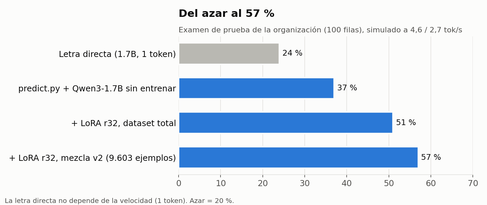

# La historia del proyecto

**Equipo Impostors** (Arnau, Biel, Júlia y Carla) · Datathon FME 2026 · reto de Qualcomm y Arduino **«Math on the Edge»** · 14-15 de noviembre de 2026.

> **In English, in one paragraph.** In 24 hours we went from a model that answered Math Kangaroo problems like a coin toss (21%) to a system that, inside an Arduino UNO Q and with its real clock, solves 69% of the organisers' practice exam (22/26 verified on the real board, every problem under 60 s). The key idea: a small model can't reason in prose at 2.7 tokens per second, but it can write a five-line Python program that the board runs in milliseconds. We trained it on almost 20,000 programs that were **executed to check they print the right answer**, averaged 10 fine-tuned models into one ("model soup"), and measured every decision with the board's clock. We rented six GPUs on vast.ai at once, driven by an automatic watcher, and used open models to manufacture data. The same model powers **Math Coach**, a classroom platform served by the board to students' phones: a hint ladder that never gives the answer away, a teacher dashboard that reads the whole class, and a tick or a cross on the LED matrix.

*La barra final marca 70 %: es la cifra con los reintentos a temperatura 0,7. Al quitarlos para cumplir la regla 11.1 del reto (temperatura 0 y semilla fija), el sistema entregado saca 69/100 en el examen de prueba y 116/242 en val: la suma no cambia.*

## En cifras

| | |
|---|---|
| Del modelo del reto a nuestro sistema, en el examen de prueba (reloj de la placa) | **21 % → 69 %** |
| En la placa real, con el servicio y el reloj de verdad | **22/26 (un 8,5 sobre 10)** y **19/21 en los problemas de solo texto (un 9 sobre 10)**; 36 s de media por problema, máximo 53,8 s |
| Problemas de M3Kang con opciones fiables tras limpiarlas | del 63 % al **90 %** (4.379 de 4.862) |
| Programas de entrenamiento, todos verificados ejecutándolos | casi **20.000** (más de 15.000 sintéticos) |
| Formas de preguntar al modelo probadas | más de 40 |
| Modelos base comparados · modelos entrenados | 13 · unos 30 |
| Exámenes registrados | 284 en la nube, 49 en la primera campaña, y decenas en la placa |
| Gráficas alquiladas en vast.ai a la vez | **6** (2 RTX PRO 6000 de 96 GB y 4 RTX 3090) |
| Modelos en memoria en la placa para examen y clase | **1** (`sopa_z10`, 1,83 GB) |

---

## Por qué creemos que es original

1. **Un modelo que no razona: programa.** En una CPU que escribe 2,7 tokens por segundo, un razonamiento en prosa no cabe en 60 s. Un programa de cinco líneas sí, y la placa lo ejecuta en milisegundos. El modelo pasa de «adivinar la letra» a **calcular un valor** que después se casa con las opciones (números, fracciones, unidades o texto).
2. **Datos que se comprueban solos.** Cada ejemplo de entrenamiento es un programa que **se ejecutó** y dio la respuesta marcada. Así se pudieron fabricar miles de ejemplos con modelos abiertos sin revisarlos a mano: el ordenador hace de corrector.
3. **M3Kang usado de cuatro maneras a la vez:**
   - **fábrica de entrenamiento:** programas verificados para sus problemas de texto, y sus problemas como plantilla de estilo para generar otros nuevos;
   - **mapa por significado** para enseñar: 810 problemas con embeddings bge-m3 en 24 familias, de donde sale «un problema parecido más fácil ya resuelto»;
   - **banco de repetidos:** el Canguro repite problemas entre niveles;
   - **banco de pruebas** para el análisis de errores por tema, idioma y nivel.

   Antes hubo que **limpiarlo**: el OCR del reto solo leía las cinco opciones en el 63 % de los problemas. Un modelo con visión las releyó, se cruzó con el OCR en tres idiomas y una segunda lectura resolvió los desacuerdos: 90 %, con una auditoría de 60/60.
4. **Datos dirigidos a los fallos.** Un mapa de 178 fallos del mejor modelo, clasificados uno a uno, dio 48 «trampas» típicas del Canguro (olvidar una condición, contar dos veces los pares, invertir una relación…). Se generaron más de 5.000 problemas nuevos apuntando justo a ellas, y otros 3.000 se tradujeron al catalán, porque en catalán se acertaba menos.
5. **Sopa de modelos.** La media de los pesos de **10 entrenamientos LoRA** distintos del mismo Qwen3-1.7B suma 20 puntos más que el mejor de ellos por separado, **sin coste en la placa**: sigue siendo un solo modelo del mismo tamaño.
6. **Todo medido con el reloj de la placa.** Medimos en la placa cuánto lee y escribe cada modelo, y simulamos esa velocidad en el PC para elegir. Descubrimos que una variante que acierta el 50 % sin límite se queda en el **19 %** con el reloj de verdad. Desde ese momento no se aceptó ninguna mejora que no sobreviviera al reloj.
7. **Un solo modelo para razonar y para enseñar.** El mismo `sopa_z10` responde el examen y escribe las pistas de Math Coach, y la plataforma de clase funciona sin red en la misma placa: los alumnos entran con el móvil y la matriz LED les responde.
8. **Ingeniería para que funcione en cualquier placa.** Un instalador que deja otra placa igual que la nuestra en un comando, la caché del prompt calentada antes del primer problema y el presupuesto de tokens según el tiempo que queda. También un `CLAUDE.md` para que cualquier asistente de IA que abra el repositorio ejecute el examen en las mejores condiciones.

---

## La historia, acto por acto

El cuaderno de laboratorio hora a hora está en [docs/cronologia-detallada.md](docs/cronologia-detallada.md), y un resumen más técnico en [docs/02-historia.md](docs/02-historia.md).

### Acto 1 · Preparar el terreno (14/11, tarde)
- **La placa, desde cero.** Configurarla con App Lab, compilar llama.cpp en la propia placa (~30 min), instalar los servicios y medir: el modelo del reto lee 10,6 tokens/s y escribe 5,8. Primera prueba: contesta «A» a todo.
- **El OCR, en la gráfica de la torre.** Pasó de 0,56 a 7,4 imágenes por segundo: las 4.862 imágenes en 12 minutos.
- **La línea base: 21,5 %.** Contestar siempre «D» da el 22,7 %. El modelo del reto no tenía preferencia por la respuesta correcta: ni cambiando la pregunta, ni con probabilidades, ni corrigiendo el sesgo por letra.
- **Limpieza de las opciones** de M3Kang: del 63 % al 90 % fiables.

### Acto 2 · Buscar por dónde (14/11, 17:00-21:00)
- **El buscador del reto no entiende catalán:** bge-small-en encuentra la versión inglesa de un problema catalán el 74 % de las veces; bge-m3, el 100 %.
- **RAG con ejemplos parecidos:** del 21 % al 25 % como mucho, y cada ejemplo cuesta hasta 65 s de lectura en la placa.
- **19:40 · Nace la idea clave:** que el modelo escriba un programa, y guardar para cada problema de entrenamiento un programa **verificado ejecutándolo**. En un test de 100 problemas, el programa ya sacaba el 41 % (el 50 % en los de texto).

### Acto 3 · La nube (14/11, 21:00 - 15/11, 01:00)
- **vast.ai.** Primera máquina a las 21:21: una RTX PRO 6000 de 96 GB, a 1,34 $/h, con **nueve LoRA entrenando a la vez**. Después llegaron más, hasta **seis máquinas**: dos RTX PRO 6000 (India y Canadá) y cuatro RTX 3090 (México y China), entre 0,15 y 1,57 $/h. Unos 2,5 $/h en el momento de más trabajo.
- **Un vigía automático** ([`codigo/nube/vigia3.py`](codigo/nube/vigia3.py)) revisa cada máquina por ssh cada 2 minutos y, si una se queda sin trabajo, **lanza la siguiente tarea de su cola**: una gráfica alquilada parada es dinero tirado.
- **Explorar con vLLM, decidir con llama.cpp.** vLLM examina una variante en 1-2 minutos. Pero solo llama.cpp con el GGUF Q8, igual que en la placa, cuenta para decidir.
- **Los techos:** Qwen3-4B y Qwen3-8B aciertan más (hasta 49,5 %), pero no caben: en la placa medimos que un 4B escribe a 1,25 tokens/s.
- **23:57 · El hallazgo del tiempo:** recortada a lo que cabe en 60 s, la mejor variante cae al 19 %. El reloj manda.
- **00:21 · Llega el examen de prueba** de la organización: 50 problemas nuevos en inglés y catalán, con las opciones solo en la imagen. Se convierte con el OCR oficial y pasa a ser la referencia, junto con val.

### Acto 4 · La fábrica de datos (15/11, 01:00-03:00)
- **Modelos abiertos de la organización (Helmcode):** DeepSeek, GLM, Qwen3.6 y Gemma4 generan miles de problemas con su programa; solo se quedan los que, al ejecutarlos, aciertan.
- **Problemas públicos** (MathQA y AQuA-RAT): el propio modelo escribe sus programas para 12.000 problemas, y se quedan los 4.606 que aciertan.
- **El primer entrenamiento que mejora lo que cabe en la placa:** del 39-41 % al 47-50 %. A las 02:49, un LoRA de rango 32 sobre el dataset total llega al **52-56 %**.
- **En la placa, de madrugada:** medimos la velocidad real de cada candidato y descubrimos tres trampas:
  - la primera lectura sin caché tarda 71-78 s;
  - cambiar de prompt de sistema tira la caché;
  - si se acaba el tiempo, se pierde todo lo escrito.

  De ahí salen el calentamiento automático, un solo prompt de sistema y el corte del programa en cuanto se cierra el bloque de código.

### Acto 5 · Afinar para la placa (15/11, 03:00-05:00)
- **Simulación con la velocidad medida (4,6 / 2,7 tokens/s):** el 1.7B sin entrenar saca el 37 %; con el LoRA, el 51 %, y después **57 %**. Ningún problema pasa de 56 s.
- **Mapa de errores del líder:** 75 de 103 problemas fallados lo son por **planteamiento**, no por cálculo ni por tiempo. Con el doble de tiempo, solo se recuperarían 6 de 74 cortados.
- **Descartados con datos:** GRPO (mejora val en la nube pero no lo que cabe en la placa), pistas de método antes del programa (cambian el programa al azar), modelos de 4 bits (la CPU de la placa no tiene `dotprod`: no van más rápido y aciertan menos).
- **Generación masiva dirigida** a las 48 trampas del mapa de errores.

### Acto 6 · La noche de las sopas (15/11, 05:00-09:30)
- **Mezclas v3, v4 y v4b** (16.000-20.000 ejemplos), entrenadas en seis máquinas a la vez.
- **La primera sopa:** promediar dos LoRA del mismo modelo ya suma más que el mejor suelto.
- **El vicio de las constantes:** un 2 % de ejemplos con programas que imprimían la respuesta sin calcularla bastó para que el modelo lo copiara. Se limpiaron los datos y `predict.py` pide otro programa si el primero solo imprime una constante.
- **Sopas cada vez más grandes** hasta **`sopa_z10`, la media de 10 modelos**: la mejor suma en el examen de prueba y en val.
- **Incidentes:** dos sopas a la vez dejaron la torre sin RAM (se reescribió para mezclar matriz a matriz); el disco se llenó; y a las 08:58 se acabó el saldo de vast.ai y las seis máquinas se pararon.
- **09:30 · Congelación** del modelo y de `predict.py`. A las 09:45 se quitaron los reintentos a temperatura 0,7 para cumplir la regla 11.1: misma suma.

### Acto 7 · Teach: Math Coach
La otra mitad del equipo construyó la parte de enseñar. Primero midió lo que daba de sí el modelo del reto: con RAG y explicaciones, como mucho un 27-35 %. Conclusión: un modelo así no es de fiar para resolver, así que **el modelo solo se usa donde su salida se puede comprobar**. Así nació **Math Coach**, una plataforma de clase que sirve la propia placa:
- **Para el alumno**, desde el móvil: práctica a su nivel, con un entrenador adaptativo que sube de nivel con los aciertos. Si se atasca, **una escalera de 4 pistas que nunca da la respuesta**:
  1. un problema parecido más fácil, ya resuelto;
  2. el tema y el método;
  3. una frase del modelo, que el código rechaza si revela la respuesta;
  4. la solución, solo si la pide.

  También hay tests, 396 lecciones paso a paso y juegos en directo por equipos. **La matriz LED** de la placa enseña el ✓ o la ✗ y el nivel.
- **Para el docente**, una **IA que lee toda la clase**, calculada en la placa y **sin modelo de lenguaje** (así no se inventa nada):
  - el nivel real de cada alumno y la dificultad real de cada problema (teoría de respuesta al ítem);
  - errores compartidos, grupos de trabajo y perfiles de ritmo;
  - análisis de preguntas;
  - «qué haría hoy», con hasta 4 acciones.
- **Medido:**
  - la pista del modelo revelaba la respuesta el 6,3 % de las veces en el primer intento, y **ninguna llega al alumno** tras los filtros;
  - la pista 1 nunca tiene el mismo valor que la respuesta;
  - los alumnos simulados se estabilizan en su nivel;
  - 4 alumnos a la vez, 50 ms por respuesta;
  - 769 de 792 soluciones traducidas al catalán y al castellano aceptadas (97,1 %).

### Acto 8 · La última milla en la placa (15/11, 09:45-13:30)
- **El modelo final llega a la placa** (1,83 GB, md5 comprobado). Prueba con el reloj de verdad: **22/26 en el examen de prueba, un 8,5 sobre 10, y 19/21 en los problemas de solo texto, un 9 sobre 10**. 36 s de media, **máximo 53,8 s**, sin calentarse (73 °C).
- **Se instala como servicio oficial** del reto. El comando del jurado, tal cual, acierta los 5 problemas de ejemplo.
- **Math Coach se integra** en la misma placa, usando el mismo modelo a través de un pequeño puente: un solo modelo en memoria y 2,4 GB libres. Comprobado que **el examen sigue cumpliendo los tiempos con la app encendida** y que la matriz LED responde desde el móvil.
- **Incidentes:**
  - una campaña de pruebas nocturna llenó el disco de la placa y se perdieron horas de medidas;
  - la placa se reinició de golpe a media mañana.

  De ahí salen dos reglas: comprobar el espacio antes de descargar, y apagar siempre con `sudo poweroff`.
- **Entrega:**
  - repositorio público, con una sección en inglés para que el jurado evalúe en **su propia placa** en 5 comandos;
  - el modelo publicado en una *release* de GitHub;
  - un `CLAUDE.md` con las reglas del examen para cualquier asistente;
  - el texto de Arduino Project Hub, enviado a revisión, con copia en [docs/project-hub-en.md](docs/project-hub-en.md).

---

## Lo que aprendimos

1. **En una CPU lenta, el tiempo es la métrica.** Lo que no cabe en 60 s no existe.
2. **Un programa verificado vale más que una explicación.** Se comprueba solo, es corto y enseña al modelo a calcular. Entrenar con explicaciones en prosa lo empeoró 9 puntos.
3. **El modelo sabe adónde ir; falla al plantear.** Pistas, ejemplos y RAG le dan el método, pero no lo ejecuta mejor. Lo que lo mueve son miles de planteamientos correctos.
4. **Medir el instrumento antes que el modelo.** Un detector de repetidos que no detectaba nada, descargas cortadas o un servidor que leía en frío solo se ven midiendo cada pieza por separado.
5. **Promediar modelos buenos y distintos suma**, sin coste en la placa.
6. **Los datos enseñan también los vicios.** Un 2 % de ejemplos malos basta para que el modelo los copie.
7. **Para enseñar, el modelo solo donde se puede comprobar.** La IA del docente funciona sin modelo de lenguaje, y las pistas del modelo pasan siempre por un filtro.
8. **Las reglas, al pie de la letra.** Temperatura 0 y semilla fija, aunque el determinismo ya estaba garantizado: quitarlo no costó nada.

## Dónde mirar

| | |
|---|---|
| Qué hace y cómo responde al reto | [README](README.md) |
| Evaluarlo en vuestra placa | [For the jury](README.md#for-the-jury-evaluate-our-system-on-your-own-board-5-commands) |
| Teach, Math Coach | [teach/README.md](teach/README.md) |
| Resultados y análisis de errores | [docs/06-resultados.md](docs/06-resultados.md) |
| Lo que no funcionó | [docs/07-lo-que-no-funciono.md](docs/07-lo-que-no-funciono.md) |
| Infraestructura (torre, vast.ai, vigía, Helmcode) | [docs/08-infraestructura.md](docs/08-infraestructura.md) |
| El modelo | [release `modelo-final`](https://github.com/Arnau000z/placa-velocidad/releases) |

M3Kang: Torres-Camps et al., 2026, [arXiv:2601.16218](https://arxiv.org/abs/2601.16218). Sus datos no se redistribuyen: licencia solo de investigación.
