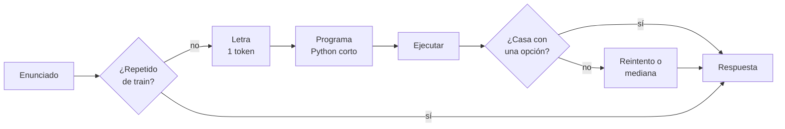

# Math on the Edge · copiloto de matemáticas en una Arduino UNO Q


-1baf7a)

Proyecto del equipo para el **Datathon FME 2026, reto de Qualcomm «Math on the Edge»**: resolver problemas del Canguro matemático (opción múltiple A-E, en inglés y catalán) con un modelo de lenguaje que corre **entero dentro de una Arduino UNO Q**. Sin red y con 60 segundos por problema, en una CPU que lee unos 4,6 tokens por segundo.

| | Acierto en el examen de prueba de la organización |
|---|---|
| Azar | 20 % |
| Baseline del reto (Qwen3.5-0.8B, letra directa) | ~21 % |
| Qwen3-1.7B sin entrenar, con nuestro `predict.py` | 37 % |
| Qwen3-1.7B + LoRA entrenado con 9.603 programas verificados | 57 % |
| Media de pesos de tres 1.7B entrenados con las mezclas v3 y v4 | 69 % |
| **Modelo final: media de pesos de diez 1.7B entrenados con las mezclas v3, v4 y v4b** | **70 %** |

*Simulado con el reloj de la placa (4,6 / 2,7 tokens/s medidos), con el mismo `predict.py` y el mismo GGUF que van a la placa.*


## Cómo funciona, en 30 segundos

1. **El modelo no razona en prosa: escribe un programa.** Qwen3-1.7B traduce el enunciado a 5-8 líneas de Python. La CPU las ejecuta en milisegundos y el resultado se casa con una de las cinco opciones. Cuando el programa casa con una opción, acierta el 90 % de las veces.
2. **El modelo está entrenado para eso.** Un LoRA sobre casi 10.000 problemas con un programa corto **ejecutado y comprobado**. Los problemas vienen de M3Kang, de problemas sintéticos de modelos abiertos y de los aciertos del propio modelo.
3. **Todo gira en torno al reloj.** El prompt de sistema va en caché y la letra se pide primero (1 token). El presupuesto de tokens se recalcula con la velocidad real, y si el programa no casa hay reintentos y una reserva por la mediana. Siempre sale una letra antes de 60 s.




## Documentación

| | |
|---|---|
| [El reto](docs/01-el-reto.md) | La placa, los datos, el formato del examen y la línea base |
| [La historia](docs/02-historia.md) | De 21 % a 57 % en cinco actos, con lo que aprendimos |
| [Cronología detallada](docs/cronologia-detallada.md) | El cuaderno de laboratorio, hora a hora |
| [El sistema](docs/03-sistema.md) | `predict.py` paso a paso: caché, presupuesto de tiempo, reserva, robustez |
| [Los modelos](docs/04-modelos.md) | 13 modelos base, 2 de embeddings, 5 generadores y unos 30 entrenados |
| [Datos y entrenamiento](docs/05-datos-y-entrenamiento.md) | Limpieza de opciones, programas verificados, datos sintéticos, recetas |
| [Resultados](docs/06-resultados.md) | Todas las pruebas y el análisis de errores por tema, idioma, nivel y causa |
| [Lo que no funcionó](docs/07-lo-que-no-funciono.md) | RAG, pistas, GRPO, 4 bits, explicaciones… y por qué |
| [Infraestructura](docs/08-infraestructura.md) | Torre, seis gráficas alquiladas, vigía automático y modelos abiertos |
| [Kit de velocidad](docs/09-kit-de-velocidad.md) | Cómo medir en la placa y lo medido hasta ahora |

## El repositorio

```
├── README.md
├── docs/                    documentación (la de arriba)
├── figuras/                 gráficas, generadas con figuras/graficas.py
├── pruebas/                 registro de todas las pruebas en CSV
├── codigo/
│   ├── entrega/             predict.py, simulación de placa y evaluación automática de candidatos
│   ├── evaluacion/          rejilla de variantes, casado de opciones, repetidos train↔val
│   ├── entrenamiento/       LoRA / ajuste completo, GRPO, exportación a GGUF, mezcla de datos
│   ├── datos_sinteticos/    generadores con modelos abiertos y verificación por ejecución
│   └── nube/                alquiler y control de máquinas, vigía con colas
├── equipo/predict.py        el predict.py que se copia a la placa
└── 00_preparar.sh … todo.sh kit de velocidad para la placa (+ subir_a_placa.ps1, traer_resultados.ps1)
```

## Reproducirlo

1. **Datos:** el `prepare_m3kang.py` del repositorio del reto, más la limpieza de opciones ([detalle](docs/05-datos-y-entrenamiento.md#limpieza-de-opciones)).
2. **Datos de entrenamiento:**
   - [`generar_helmcode.py`](codigo/datos_sinteticos/generar_helmcode.py) genera problemas sintéticos con modelos abiertos.
   - [`verificar_sintetico.py`](codigo/datos_sinteticos/verificar_sintetico.py) los ejecuta y se queda con los que aciertan.
   - [`mezclar_sft.py`](codigo/entrenamiento/mezclar_sft.py) junta todas las fuentes.
3. **Entrenar y exportar en una gráfica de 24 GB o más:**
   ```bash
   bash trabajo_lora_total.sh 17b_lora32_v2 3 1e-4 32 sft_codigo_v2.jsonl
   ```
   Entrena el LoRA r32 de 3 épocas, lo exporta a GGUF Q8_0 y lo examina.
4. **Simular la placa** desde el PC:
   ```bash
   python codigo/entrega/sim_demo.py http://127.0.0.1:8095 nombre --reserva mediana
   ```
5. **En la placa:**
   ```powershell
   .\subir_a_placa.ps1 -Extra modelo-Q8_0.gguf
   ```
   ```bash
   PRINCIPAL=modelo-Q8_0.gguf ./todo.sh rapido
   ```

## Datos y licencias

M3Kang tiene licencia **solo para investigación**. Este repositorio **no incluye ningún enunciado, imagen ni índice de M3Kang**, solo identificadores de problema y resultados agregados. Los datos de entrenamiento y los modelos entrenados se quedan fuera del repositorio.

## Estado (15/11/2026, 09:30): modelo congelado

- **Modelo final:** `sopa_z10-Q8_0.gguf` (1,83 GB), la media de los pesos de **10 Qwen3-1.7B** entrenados con LoRA r32 sobre las mezclas v3, v4 y v4b, con varias semillas y ritmos de aprendizaje.
  - Examen de prueba: **70/100** a velocidad de placa (texto 64/80, figura 6/20).
  - Val en inglés y catalán, sin repetidos: 115/242 (48 %).
  - Simulado a 4,6 / 2,7 tokens/s: 39-43 s por problema de media y 52-58 s como máximo.
- **`predict.py`:** el de `equipo/`, sin cambios desde las 08:10.
- **Lo último que queda:** comprobar en la placa que ningún problema pasa de 60 s, incluido el primero, que se lee en frío, y entregar a partir de las 12:00.
