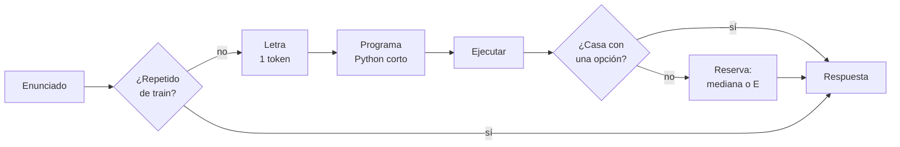
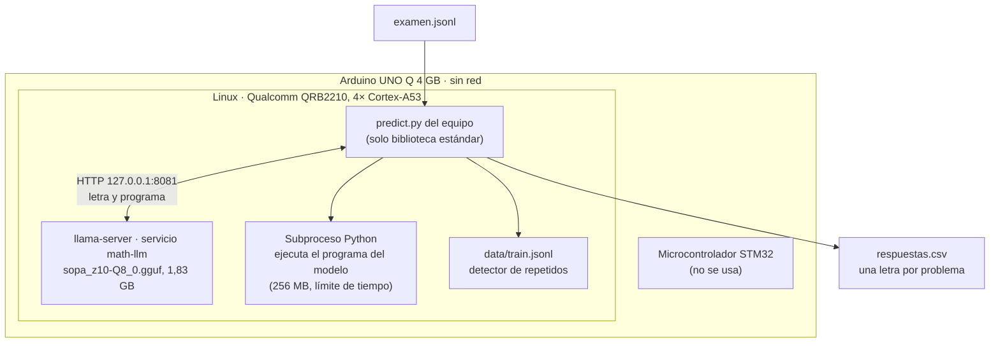

# Math on the Edge · copiloto de matemáticas en una Arduino UNO Q


-1baf7a)

Proyecto del equipo para el **Datathon FME 2026, reto de Qualcomm «Math on the Edge»**: resolver problemas del Canguro matemático (opción múltiple A-E, en inglés y catalán) con un modelo de lenguaje que corre **entero dentro de una Arduino UNO Q**. Sin red y con 60 segundos por problema, en una CPU que lee unos 4,6 tokens por segundo.

| | Acierto en el examen de prueba de la organización |
|---|---|
| Azar | 20 % |
| Baseline del reto (Qwen3.5-0.8B, letra directa) | ~21 % |
| Qwen3-1.7B sin entrenar, con nuestro `predict.py` | 37 % |
| Qwen3-1.7B + LoRA entrenado con 9.603 programas verificados | 57 % |
| Media de pesos de tres 1.7B entrenados con las mezclas v3 y v4 | 69 % |
| **Modelo final: media de pesos de diez 1.7B entrenados con las mezclas v3, v4 y v4b** | **69 %** |

*Simulado con el reloj de la placa (4,6 / 2,7 tokens/s medidos), con el mismo `predict.py` y el mismo GGUF que van a la placa.*

## Probar el sistema completo en la placa (3 pasos)

Hace falta la placa con el repo del reto ya montado (pasos 0-10 de su README) y conectada por USB-C al PC.

**1. En el PC:** copia este kit, nuestro `predict.py` y el modelo final (1,83 GB, unos minutos por USB):
```powershell
cd D:\Datathon_A\placa-velocidad
.\subir_a_placa.ps1 -Extra D:\Datathon_A\modelos_entrenados\sopa_z10-Q8_0.gguf
```

**2. En la placa:** instala el sistema y lo prueba con 6 problemas y el reloj de verdad:
```bash
cd ~/placa-velocidad && ./instalar_en_placa.sh
```
Hace cuatro cosas:
- Comprueba el md5 del modelo.
- Pone `LLM_FILE=sopa_z10-Q8_0.gguf` en el `config.env` del reto.
- Reinstala los servicios con el script oficial `board/04_install_services.sh` (pide `sudo`).
- Copia nuestro `predict.py` al repo del reto; el original queda como `predict_oficial.py`.

Al acabar enseña una tabla con cada problema: respuesta, si acierta, segundos y vía. Termina en **«BIEN: ningún problema pasa de 60 s»** u **«OJO»**.

**3. Así lo ejecutará el jurado** (es lo que acaba de probar el paso 2):
```bash
cd ~/datathon-UPC-maths-qualcomm-arduino-unoq
python3 predict.py --input examen.jsonl --output respuestas.csv
```

| Otros usos | |
|---|---|
| `N=20 ./instalar_en_placa.sh --probar` | Solo la prueba, con 20 problemas, sin tocar nada |
| `./instalar_en_placa.sh --deshacer` | Vuelve al modelo y al `predict.py` del reto |
| `PRINCIPAL=sopa_z10-Q8_0.gguf ./todo.sh rapido` | Medida completa (velocidad, memoria, calor y cadena), unos 15 min |
| `.\traer_resultados.ps1` (en el PC) | Trae los resultados de la placa |

| Modelo final | |
|---|---|
| Fichero | `sopa_z10-Q8_0.gguf`, 1.834.426.208 bytes, md5 `c1ba1d47e8f818378e27be6a7c1a01b2` |
| Qué es | La media de los pesos de 10 Qwen3-1.7B entrenados con LoRA r32 (mezclas v3, v4 y v4b), exportada a GGUF Q8_0 |
| Dónde está | `D:\Datathon_A\modelos_entrenados\` en la torre y como adjunto de la *release* `modelo-final` de este repositorio |


## Cómo funciona, en 30 segundos

1. **El modelo no razona en prosa: escribe un programa.** Qwen3-1.7B traduce el enunciado a 5-8 líneas de Python. La CPU las ejecuta en milisegundos y el resultado se casa con una de las cinco opciones. Cuando el programa casa con una opción, acierta el 90 % de las veces.
2. **El modelo está entrenado para eso.** Un LoRA sobre casi 10.000 problemas con un programa corto **ejecutado y comprobado**. Los problemas vienen de M3Kang, de problemas sintéticos de modelos abiertos y de los aciertos del propio modelo.
3. **Todo gira en torno al reloj.** El prompt de sistema va en caché y la letra se pide primero (1 token). El presupuesto de tokens se recalcula con la velocidad real. Si el programa no casa con ninguna opción, se usa la reserva: la mediana de las opciones si son números, o E. Siempre sale una letra antes de 60 s, con temperatura 0 y semilla fija.




## Arquitectura



- **Todo corre en la parte Linux.** El microcontrolador no interviene: el reto se puntúa con `predict.py` y el cuello de botella es la CPU.
- **Un solo modelo en memoria:** el servicio oficial `math-llm`, con los ajustes del reto (contexto de 4.096 tokens, 4 hilos, `--reasoning off`). El servicio de embeddings sigue instalado, pero nuestro `predict.py` no lo usa.
- **Cómo usamos M3Kang:**
  1. **Como fábrica de entrenamiento.** Programas verificados por ejecución para sus problemas de texto, y problemas suyos como referencia de estilo para generar miles de problemas nuevos.
  2. **Como banco de repetidos.** El Canguro repite problemas entre niveles; si llega uno con las mismas opciones, se contesta en 2 ms.
  3. **Como banco de pruebas.** Val en inglés y catalán, y el análisis de errores por tema, idioma y nivel.

  El RAG con ejemplos parecidos se probó y se descartó: [por qué](docs/07-lo-que-no-funciono.md#rag-con-bge-m3).

## Montarlo en una placa nueva

Desde una UNO Q con los pasos 0-10 del [repositorio del reto](https://github.com/mpous/datathon-UPC-maths-qualcomm-arduino-unoq) hechos y con red:
```bash
git clone https://github.com/Arnau000z/placa-velocidad.git ~/placa-velocidad
cd ~/placa-velocidad && ./instalar_en_placa.sh
```
Si el modelo no está en `~/models`, el instalador lo baja de la [*release* `modelo-final`](https://github.com/Arnau000z/placa-velocidad/releases/tag/modelo-final). Las líneas de `config.env` que cambian están en [`config.env.equipo`](config.env.equipo), con el SHA256 del modelo.

## Demo en directo

```bash
cd ~/placa-velocidad && python3 demo.py
```
Pasa por el `predict.py` y el servicio reales 6 problemas inventados por el equipo ([`problemas_demo.jsonl`](problemas_demo.jsonl)), en inglés y catalán. Para cada uno enseña:
- el enunciado;
- la letra rápida;
- el programa que escribe el modelo;
- lo que imprime al ejecutarlo;
- la respuesta y los segundos, con un reloj de 60 s.

Con `--seguido` no espera a Enter entre problemas. El guion del pitch está en [docs/pitch.md](docs/pitch.md).

## Experimentos frente a la línea base

Los cambios que más movieron la nota, en orden. Todas las pruebas, con su conjunto y su ruido, están en [Resultados](docs/06-resultados.md); los registros en CSV, en [`pruebas/`](pruebas).

| # | Cambio | Medido en | Resultado |
|---|---|---|---|
| 0 | **Línea base del reto:** Qwen3.5-0.8B, letra directa | val (789) | 21,0 % (contestar siempre D: 22,7 %) |
| 1 | Cinco formas distintas de pedir la letra | val (789) | 17-21,8 %: sin efecto |
| 2 | RAG con 2 ejemplos parecidos (bge-m3) | val (789) | 25,3 % |
| 3 | Qwen3.5-2B razonando en ≤ 60 palabras | muestra (200) | 34,5 % |
| 4 | **Programa en Python** con código verificado de 2 problemas parecidos | T100 | 41 % (texto 50 %) |
| 5 | Qwen3-1.7B con el sistema completo | val (789) | 35,5 % (texto 46 %) |
| 6 | Casar el valor en vez de pedir la letra | val texto (349) | +5,7 puntos |
| 7 | **Con el reloj de la placa:** programa corto → mediana | demo (100) | 45 % (sin reloj, 58 %) |
| 8 | Ajuste fino con explicaciones en prosa | val texto (349) | −9 puntos (descartado) |
| 9 | `predict.py` final, 1.7B sin entrenar, reloj de placa | demo (100) | 37 % |
| 10 | + LoRA con 516 programas propios verificados | demo, cadena de placa | 47-50 % (antes 39-41 %) |
| 11 | + LoRA r32 con ~10.000 programas verificados | demo (100) | 51 % → 57 % |
| 12 | + Media de pesos de varios LoRA («sopa») | demo (100) | 60 % → 69 % |
| 13 | **Modelo final** `sopa_z10`, temperatura 0 | demo (100) · val texto (242) | **69 %** · **116/242 (48 %)** |

## Documentación

| | |
|---|---|
| [El reto](docs/01-el-reto.md) | La placa, los datos, el formato del examen y la línea base |
| [La historia](docs/02-historia.md) | De 21 % a 57 % en cinco actos, con lo que aprendimos |
| [Cronología detallada](docs/cronologia-detallada.md) | El cuaderno de laboratorio, hora a hora |
| [El sistema](docs/03-sistema.md) | `predict.py` paso a paso: caché, presupuesto de tiempo, reserva, robustez |
| [Los modelos](docs/04-modelos.md) | 13 modelos base, 2 de embeddings, 5 generadores y unos 30 entrenados |
| [Datos y entrenamiento](docs/05-datos-y-entrenamiento.md) | Limpieza de opciones, programas verificados, datos sintéticos, recetas |
| [Resultados](docs/06-resultados.md) | Todas las pruebas y el análisis de errores por tema, idioma, nivel y causa |
| [Lo que no funcionó](docs/07-lo-que-no-funciono.md) | RAG, pistas, GRPO, 4 bits, explicaciones… y por qué |
| [Infraestructura](docs/08-infraestructura.md) | Torre, seis gráficas alquiladas, vigía automático y modelos abiertos |
| [Kit de velocidad](docs/09-kit-de-velocidad.md) | Cómo medir en la placa y lo medido hasta ahora |

## El repositorio

```
├── README.md
├── docs/                    documentación (la de arriba)
├── figuras/                 gráficas, generadas con figuras/graficas.py
├── pruebas/                 registro de todas las pruebas en CSV
├── codigo/
│   ├── entrega/             predict.py, simulación de placa y evaluación automática de candidatos
│   ├── evaluacion/          rejilla de variantes, casado de opciones, repetidos train↔val
│   ├── entrenamiento/       LoRA / ajuste completo, GRPO, exportación a GGUF, mezcla de datos
│   ├── datos_sinteticos/    generadores con modelos abiertos y verificación por ejecución
│   └── nube/                alquiler y control de máquinas, vigía con colas
├── equipo/predict.py        el predict.py que se copia a la placa
└── 00_preparar.sh … todo.sh kit de velocidad para la placa (+ subir_a_placa.ps1, traer_resultados.ps1)
```

## Reproducirlo

1. **Datos:** el `prepare_m3kang.py` del repositorio del reto, más la limpieza de opciones ([detalle](docs/05-datos-y-entrenamiento.md#limpieza-de-opciones)).
2. **Datos de entrenamiento:**
   - [`generar_helmcode.py`](codigo/datos_sinteticos/generar_helmcode.py) genera problemas sintéticos con modelos abiertos.
   - [`verificar_sintetico.py`](codigo/datos_sinteticos/verificar_sintetico.py) los ejecuta y se queda con los que aciertan.
   - [`mezclar_sft.py`](codigo/entrenamiento/mezclar_sft.py) junta todas las fuentes.
3. **Entrenar y exportar en una gráfica de 24 GB o más:**
   ```bash
   bash trabajo_lora_total.sh 17b_lora32_v2 3 1e-4 32 sft_codigo_v2.jsonl
   ```
   Entrena el LoRA r32 de 3 épocas, lo exporta a GGUF Q8_0 y lo examina.
4. **Simular la placa** desde el PC:
   ```bash
   python codigo/entrega/sim_demo.py http://127.0.0.1:8095 nombre --reserva mediana
   ```
5. **En la placa:**
   ```powershell
   .\subir_a_placa.ps1 -Extra modelo-Q8_0.gguf
   ```
   ```bash
   PRINCIPAL=modelo-Q8_0.gguf ./todo.sh rapido
   ```

## Datos y licencias

- **Código:** licencia [MIT](LICENSE).
- **M3Kang:** licencia **solo para investigación**. Este repositorio **no incluye ningún enunciado, imagen ni índice de M3Kang**, solo identificadores de problema y resultados agregados. Ficha del dataset: [qualcomm/M3Kang](https://huggingface.co/datasets/qualcomm/M3Kang). Cita: Torres-Camps et al., 2026, [arXiv:2601.16218](https://arxiv.org/abs/2601.16218).
- **Lo que queda fuera:** los datos de entrenamiento y los modelos intermedios. El modelo final está en la *release*.

## Equipo

- Arnau
- Carla
- Biel
- Júlia

Reto de Qualcomm del Datathon FME 2026 (UPC).

## Estado (15/11/2026, 09:30): modelo congelado

- **Modelo final:** `sopa_z10-Q8_0.gguf` (1,83 GB), la media de los pesos de **10 Qwen3-1.7B** entrenados con LoRA r32 sobre las mezclas v3, v4 y v4b, con varias semillas y ritmos de aprendizaje.
  - Examen de prueba: **69/100** a velocidad de placa (texto 64/80, figura 5/20).
  - Val en inglés y catalán, sin repetidos: 116/242 (48 %).
  - Simulado a 4,6 / 2,7 tokens/s: 38-42 s por problema de media y 52-58 s como máximo.
  - Todo a temperatura 0 y semilla fija (regla 11.1 del reto): sin reintentos a temperatura 0,7, la suma no cambia (185).
- **`predict.py`:** el de `equipo/` (md5 `d76ccf6ce89a9c6367911f2df5b1243d`), congelado a las 09:45.
- **Lo último que queda:** comprobar en la placa que ningún problema pasa de 60 s, incluido el primero, que se lee en frío, y entregar a partir de las 12:00.
