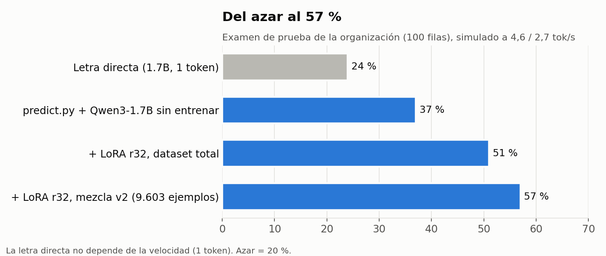
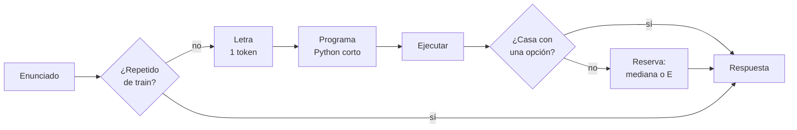
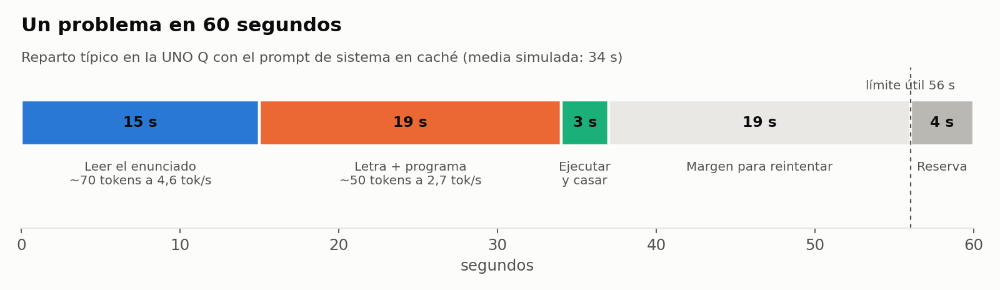
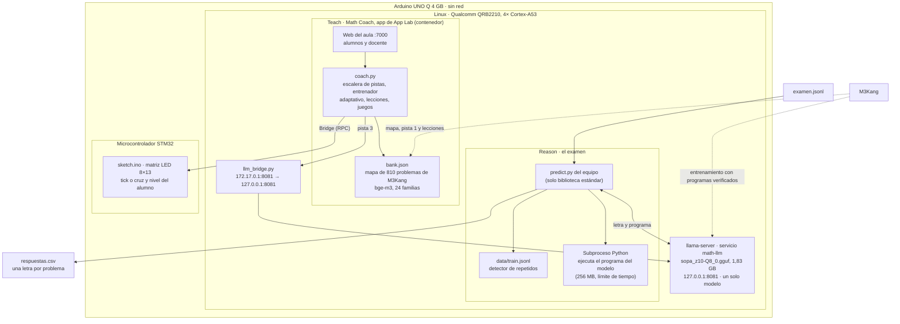

# Math on the Edge · copiloto de matemáticas en una Arduino UNO Q


-1baf7a)

Proyecto del equipo para el **Datathon FME 2026, reto de Qualcomm «Math on the Edge»**: resolver problemas del Canguro matemático (opción múltiple A-E, en inglés y catalán) con un modelo de lenguaje que corre **entero dentro de una Arduino UNO Q**. Sin red y con 60 segundos por problema, en una CPU que lee unos 4,6 tokens por segundo.

| | Acierto en el examen de prueba de la organización |
|---|---|
| Azar | 20 % |
| Baseline del reto (Qwen3.5-0.8B, letra directa) | ~21 % |
| Qwen3-1.7B sin entrenar, con nuestro `predict.py` | 37 % |
| Qwen3-1.7B + LoRA entrenado con 9.603 programas verificados | 57 % |
| Media de pesos de tres 1.7B entrenados con las mezclas v3 y v4 | 69 % |
| **Modelo final: media de pesos de diez 1.7B entrenados con las mezclas v3, v4 y v4b** | **69 %** |

*Simulado con el reloj de la placa (4,6 / 2,7 tokens/s medidos), con el mismo `predict.py` y el mismo GGUF que van a la placa.* **Comprobado después en la placa real** (15/11): 22/26 problemas del examen de prueba, 36 s de media por problema y 54 s como máximo, ninguno por encima de 60 s ([detalle](#verificación-en-la-placa-real-15112026)).

> **In English.** Our entry for the Qualcomm "Math on the Edge" challenge (Datathon FME 2026) does both things the challenge asks for, fully offline on one Arduino UNO Q 4 GB:
> - **Reason:** a Qwen3-1.7B fine-tuned with LoRA (an average of 10 runs, `sopa_z10`, GGUF Q8_0) does not reason in prose: it writes a short Python program that the board runs and matches against the five options. 69% on the organisers' practice exam with the board's clock (baseline 21%), 22/26 verified on the real board, every problem under 60 s. Entry point: [`equipo/predict.py`](equipo/predict.py); installer: [`instalar_en_placa.sh`](instalar_en_placa.sh); model: the [`modelo-final` release](https://github.com/Arnau000z/placa-velocidad/releases).
> - **Teach:** [Math Coach](teach/README.md), an App Lab app served by the board to the classroom (port 7000): Kangaroo problems at each student's level, a hint ladder that never gives the answer away (similar easier solved problem from an M3Kang map, then topic and method, then one sentence from the same model, filtered by code), tests, lessons, live games, a teacher's skills map, and a tick/cross and the level on the LED matrix.
> - **Project Hub write-up:** submitted on 15/11/2026 and waiting for Arduino's moderators; the full text, with screenshots, is here offline: [docs/project-hub-en.md](docs/project-hub-en.md).
> - **Results and error analysis** by topic, language, level and cause: [below](#análisis-de-errores-tema-idioma-nivel-y-causa) and in [docs/06-resultados.md](docs/06-resultados.md). The rest of this README is in Spanish.

## Entregables del reto

| Entregable (Step 15 del reto) | Dónde | Estado |
|---|---|---|
| **Repositorio público en GitHub** | este repositorio: <https://github.com/Arnau000z/placa-velocidad> | ✅ público |
| **Texto en Arduino Project Hub** | enviado el 15/11/2026: <https://projecthub.arduino.cc/projects/4cd45721-2a96-45e8-bc74-d6429d50f2ba/preview> | ⏳ **en revisión por los moderadores de Arduino**. Hasta que lo aprueben, ese enlace solo lo ve el equipo. Copia completa aquí: [docs/project-hub-en.md](docs/project-hub-en.md) |
| **`predict.py` para el test oculto** | [`equipo/predict.py`](equipo/predict.py), instalado en la placa con [`instalar_en_placa.sh`](instalar_en_placa.sh) | ✅ verificado en la placa real |
| **Demo en directo y pitch de 3 min** | [`demo.py`](demo.py) (Reason), la app [Math Coach](teach/README.md) (Teach) y el guion [docs/pitch.md](docs/pitch.md) | ✅ |

**Lista del Step 15.1 (README del repositorio):**

| Lo que pide | Dónde está |
|---|---|
| Código para una UNO Q nueva: `config.env` con repositorio, revisión, fichero y SHA256 de los modelos, servicios y la app de App Lab | [`config.env.equipo`](config.env.equipo) y [`teach/config.env`](teach/config.env) (modelo `sopa_z10`, SHA256 incluido), servicios en [`teach/board/systemd/`](teach/board/systemd/), app en [`teach/app/math-coach/`](teach/app/math-coach/) |
| Qué hace el copiloto, con foto o vídeo | [Cómo responde el proyecto al reto](#cómo-responde-el-proyecto-al-reto), [Teach](#teach-math-coach-la-plataforma-de-clase-en-la-placa) y capturas en [`teach/docs/screenshots/`](teach/docs/screenshots/). **Pendiente: una foto o un vídeo de la placa con la matriz LED** |
| Arquitectura: Linux, microcontrolador y M3Kang | [Arquitectura](#arquitectura) |
| Cómo replicarlo paso a paso | [Montarlo en una placa nueva](#montarlo-en-una-placa-nueva), [Probar el sistema completo](#probar-el-sistema-completo-en-la-placa-3-pasos) y [teach/README.md](teach/README.md#how-to-replicate-it-step-by-step) |
| Resultados frente a la línea base | [Experimentos frente a la línea base](#experimentos-frente-a-la-línea-base) y [`teach/docs/results/ablations.csv`](teach/docs/results/ablations.csv) |
| Análisis de errores por tema, idioma y dificultad | [Análisis de errores](#análisis-de-errores-tema-idioma-nivel-y-causa) |
| Lo que no funcionó | [Lo que no funcionó](#lo-que-no-funcionó) |
| Equipo y licencia | [Equipo](#equipo), [MIT](LICENSE) |
| Sin datos de M3Kang | [Datos y licencias](#datos-y-licencias): ni enunciados, ni imágenes, ni índices |

## Cómo responde el proyecto al reto

El reto pide un copiloto que **haga las dos cosas** dentro de la placa: **Reason** (acertar el test oculto) y **Teach** (guiar al alumno sin darle la respuesta). Nuestra respuesta son dos piezas que comparten la misma placa y **el mismo modelo**: `sopa_z10` para razonar y **Math Coach** para enseñar.

| Lo que pide el reto | Cómo lo resolvemos | La prueba |
|---|---|---|
| **Reason:** elegir la respuesta correcta en un test oculto | `sopa_z10` (Qwen3-1.7B + LoRA, media de 10 entrenamientos) escribe un programa de Python, la placa lo ejecuta y el resultado se casa con las opciones ([`equipo/predict.py`](equipo/predict.py)) | 69 % en el examen de prueba con el reloj de la placa (línea base 21 %); **22/26 en la placa real**; 48 % en val, que nunca se usó para elegir |
| **Teach:** guiar sin dar la respuesta (pistas, práctica adaptativa, análisis de errores, interacción, colaboración) | **Math Coach** ([`teach/`](teach/README.md)): escalera de 4 pistas, entrenador adaptativo por nivel, tests, 396 lecciones paso a paso, juegos en directo por equipos y mapa de habilidades para el docente | La pista 3 revelaba la respuesta el 6,3 % de las veces en el primer intento y **ninguna llega al alumno** tras los filtros; la pista 1 nunca tiene el mismo valor que la respuesta; los alumnos simulados se estabilizan en su nivel; 4 alumnos a la vez, 50 ms por respuesta |
| **Todo dentro de la placa, sin red** | Servicio oficial `math-llm` con llama.cpp; Math Coach llega al modelo por un puente local (`172.17.0.1` → `127.0.0.1`), nunca por la Wi-Fi | La Wi-Fi solo sirve para que los móviles del aula abran la web de la placa |
| **60 s por problema y 4 GB de RAM** | Caché del prompt de sistema, presupuesto de tokens según el tiempo que queda, parada al cerrar el código; **un solo modelo en memoria** para examen y clase | Máximo 53,8 s en la placa; el servidor ocupa 2,3 GB y quedan 2,4 GB libres con Math Coach encendido |
| **Usar M3Kang de forma original** | Como **fábrica de entrenamiento** (programas verificados por ejecución), como **mapa por significado** (810 problemas, embeddings bge-m3, 24 familias) del que salen la pista 1 y la práctica, como **banco de lecciones** y como **banco de pruebas** | Del 37 % al 69 % entrenando con programas verificados; las familias del mapa agrupan problemas del mismo tema |
| **Usar la placa: matriz LED e interacción** | El microcontrolador muestra ✓ o ✗ al responder y el nivel del alumno (sketch de [`teach/app/math-coach/sketch/`](teach/app/math-coach/sketch/)); los alumnos se conectan **con su móvil** a la web de la placa para practicar, examinarse y jugar en directo | **Comprobado en la placa (15/11):** al responder desde el móvil, la matriz enseña el ✓ o la ✗ al momento |
| **Medirlo y analizar los errores** por tema, idioma y dificultad | Todas las pruebas registradas en CSV y analizadas | [Análisis de errores](#análisis-de-errores-tema-idioma-nivel-y-causa) y [docs/06-resultados.md](docs/06-resultados.md) |

**Los obstáculos que tuvo que superar `sopa_z10`**, uno a uno:
1. **Una CPU que escribe 2,7 tokens por segundo:** en 60 s no cabe un razonamiento en prosa. → El modelo escribe un programa de ~50 tokens y la placa hace las cuentas en milisegundos.
2. **Un modelo pequeño que plantea mal:** el 1.7B sin entrenar acertaba el 37 %. → LoRA con ~20.000 problemas cuyo programa se **ejecutó** para comprobar que da la respuesta correcta, y la media de los pesos de 10 entrenamientos: 69 %.
3. **El reloj:** sin caché, el primer problema tardaba 71-78 s. → Prompt de sistema fijo que el servidor reaprovecha, calentamiento antes del primer problema y presupuesto de tokens según el tiempo que queda.
4. **El catalán:** 14 puntos por detrás en el examen de prueba. → Datos de entrenamiento dirigidos al catalán: la distancia en val baja a 6 puntos.
5. **Las figuras:** el modelo no las ve. → Letra de reserva; son el 20 % del examen y el límite honesto del sistema.
6. **Las reglas del reto:** temperatura 0 y semilla fija. → Sin reintentos aleatorios: el mismo examen da siempre las mismas respuestas.

## Probar el sistema completo en la placa (3 pasos)

Hace falta la placa con el repo del reto ya montado (pasos 0-10 de su README) y conectada por USB-C al PC.

**1. En el PC:** copia este kit, nuestro `predict.py` y el modelo final (1,83 GB, unos minutos por USB). El modelo se descarga de la [*release* `modelo-final`](https://github.com/Arnau000z/placa-velocidad/releases); si la placa tiene red, `instalar_en_placa.sh` lo baja solo (ver [Montarlo en una placa nueva](#montarlo-en-una-placa-nueva)):
```powershell
cd D:\Datathon_A\placa-velocidad
.\subir_a_placa.ps1 -Extra D:\Datathon_A\modelos_entrenados\sopa_z10-Q8_0.gguf
```

**2. En la placa:** instala el sistema y lo prueba con 6 problemas y el reloj de verdad:
```bash
cd ~/placa-velocidad && ./instalar_en_placa.sh
```
Hace cuatro cosas:
- Comprueba el md5 del modelo.
- Pone `LLM_FILE=sopa_z10-Q8_0.gguf` en el `config.env` del reto.
- Reinstala los servicios con el script oficial `board/04_install_services.sh` (pide `sudo`).
- Copia nuestro `predict.py` al repo del reto; el original queda como `predict_oficial.py`.

Al acabar enseña una tabla con cada problema: respuesta, si acierta, segundos y vía. Termina en **«BIEN: ningún problema pasa de 60 s»** u **«OJO»**.

**3. Así lo ejecutará el jurado** (es lo que acaba de probar el paso 2):
```bash
cd ~/datathon-UPC-maths-qualcomm-arduino-unoq
python3 predict.py --input examen.jsonl --output respuestas.csv
```

| Otros usos | |
|---|---|
| `N=20 ./instalar_en_placa.sh --probar` | Solo la prueba, con 20 problemas, sin tocar nada |
| `./instalar_en_placa.sh --deshacer` | Vuelve al modelo y al `predict.py` del reto |
| `PRINCIPAL=sopa_z10-Q8_0.gguf ./todo.sh rapido` | Medida completa (velocidad, memoria, calor y cadena), unos 15 min |
| `.\traer_resultados.ps1` (en el PC) | Trae los resultados de la placa |

| Modelo final | |
|---|---|
| Fichero | `sopa_z10-Q8_0.gguf`, 1.834.426.208 bytes, md5 `c1ba1d47e8f818378e27be6a7c1a01b2` |
| Qué es | La media de los pesos de 10 Qwen3-1.7B entrenados con LoRA r32 (mezclas v3, v4 y v4b), exportada a GGUF Q8_0 |
| Dónde está | Adjunto a la *release* [`modelo-final`](https://github.com/Arnau000z/placa-velocidad/releases) de este repositorio (copia del equipo en `D:\Datathon_A\modelos_entrenados\`) |



## Teach: Math Coach, la plataforma de clase en la placa

El reto pide las dos cosas: **Reason** (el examen, todo lo de arriba) y **Teach**. La parte Teach es **Math Coach**, una app de App Lab que corre en la misma placa. Todo el detalle está en [`teach/README.md`](teach/README.md) y en [`teach/app/math-coach/README.md`](teach/app/math-coach/README.md), con capturas en [`teach/docs/screenshots/`](teach/docs/screenshots/).

- **Para el alumno:** problemas del Canguro a su nivel, una **escalera de pistas que nunca da la respuesta** (1: un problema parecido más fácil ya resuelto; 2: el tema y el método; 3: una frase del modelo, que se descarta si revela la respuesta; 4: la solución, solo si la pide), tests, lecciones paso a paso y juegos en directo. La **matriz LED** muestra un tick o una cruz y el nivel.
- **Para el docente:** resumen de la clase, mapa de habilidades por tema y nivel, y un asistente.
- **M3Kang como mapa:** 810 problemas con embeddings bge-m3 agrupados en 24 familias por significado; de ahí sale el problema parecido más fácil de la pista 1.
- **Un solo modelo para todo:** la pista 3 la escribe **el mismo `sopa_z10` del examen**, a través del servicio `math-llm`. Un puente (`teach/app/math-coach/board/llm_bridge.py`) deja que el contenedor de App Lab llegue a `127.0.0.1:8081` sin exponer el modelo a la red. No se carga ningún modelo más: RAM libre con todo encendido, ~2,4 GB.

**Cómo convive con el examen (comprobado en la placa el 15/11):**
```bash
# arrancar la app (en la placa); abrir http://<ip-placa>:7000 desde la misma Wi-Fi
bash ~/math-coach-src/math-coach/deploy/install_on_board.sh --restart
# ANTES DEL EXAMEN: pararla, para que ninguna pista le quite el modelo a predict.py (una sola ranura, 60 s por problema)
arduino-app-cli app stop ~/ArduinoApps/math-coach
```
El mapa de problemas (`bank.json`) y las soluciones escritas contienen texto de M3Kang (licencia solo de investigación): no están en el repositorio y se generan con el paso 2 de [`teach/README.md`](teach/README.md).

## Cómo funciona, en 30 segundos

1. **El modelo no razona en prosa: escribe un programa.** Qwen3-1.7B traduce el enunciado a 5-8 líneas de Python. La CPU las ejecuta en milisegundos y el resultado se casa con una de las cinco opciones. Cuando el programa casa con una opción, acierta el 90 % de las veces.
2. **El modelo está entrenado para eso.** Un LoRA sobre casi 10.000 problemas con un programa corto **ejecutado y comprobado**. Los problemas vienen de M3Kang, de problemas sintéticos de modelos abiertos y de los aciertos del propio modelo.
3. **Todo gira en torno al reloj.** El prompt de sistema va en caché y la letra se pide primero (1 token). El presupuesto de tokens se recalcula con la velocidad real. Si el programa no casa con ninguna opción, se usa la reserva: la mediana de las opciones si son números, o E. Siempre sale una letra antes de 60 s, con temperatura 0 y semilla fija.





## Arquitectura



- **Linux hace el trabajo pesado:** el servicio oficial `math-llm` carga **un solo modelo**, `sopa_z10`, con los ajustes del reto (contexto de 4.096 tokens, 4 hilos, `--reasoning off`). Lo usan las dos partes: `predict.py` para el examen y Math Coach para la pista 3. El servicio de embeddings del reto sigue instalado, pero ninguna de las dos lo necesita en marcha: los vectores del mapa ya van dentro de `bank.json`.
- **El microcontrolador** (STM32) solo lo usa Teach: Math Coach le manda por el *Bridge* de App Lab el tick o la cruz de cada respuesta y el nivel del alumno, y el sketch lo dibuja en la matriz LED. El examen no lo necesita.
- **El contenedor de App Lab no ve `127.0.0.1` del sistema:** un puente mínimo ([`llm_bridge.py`](teach/app/math-coach/board/llm_bridge.py)) escucha solo en la interfaz de Docker y reenvía al modelo. Nada se expone a la Wi-Fi salvo la web del aula.
- **Cómo usamos M3Kang:**
  1. **Como fábrica de entrenamiento.** Programas verificados por ejecución para sus problemas de texto, y problemas suyos como referencia de estilo para generar miles de problemas nuevos.
  2. **Como banco de repetidos.** El Canguro repite problemas entre niveles; si llega uno con las mismas opciones, se contesta en 2 ms.
  3. **Como banco de pruebas.** Val en inglés y catalán, y el análisis de errores por tema, idioma y nivel.

  El RAG con ejemplos parecidos se probó y se descartó: [por qué](docs/07-lo-que-no-funciono.md#rag-con-bge-m3).

## Montarlo en una placa nueva

Desde una UNO Q con los pasos 0-10 del [repositorio del reto](https://github.com/mpous/datathon-UPC-maths-qualcomm-arduino-unoq) hechos y con red:
```bash
git clone https://github.com/Arnau000z/placa-velocidad.git ~/placa-velocidad
cd ~/placa-velocidad && ./instalar_en_placa.sh
```
Si el modelo no está en `~/models`, el instalador lo baja de la [*release* `modelo-final`](https://github.com/Arnau000z/placa-velocidad/releases/tag/modelo-final). Las líneas de `config.env` que cambian están en [`config.env.equipo`](config.env.equipo), con el SHA256 del modelo.

## Demo en directo

```bash
cd ~/placa-velocidad && python3 demo.py
```
Pasa por el `predict.py` y el servicio reales 6 problemas inventados por el equipo ([`problemas_demo.jsonl`](problemas_demo.jsonl)), en inglés y catalán. Para cada uno enseña:
- el enunciado;
- la letra rápida;
- el programa que escribe el modelo;
- lo que imprime al ejecutarlo;
- la respuesta y los segundos, con un reloj de 60 s.

Con `--seguido` no espera a Enter entre problemas. El guion del pitch está en [docs/pitch.md](docs/pitch.md).

## Experimentos frente a la línea base

Los cambios que más movieron la nota, en orden. Todas las pruebas, con su conjunto y su ruido, están en [Resultados](docs/06-resultados.md); los registros en CSV, en [`pruebas/`](pruebas).

| # | Cambio | Medido en | Resultado |
|---|---|---|---|
| 0 | **Línea base del reto:** Qwen3.5-0.8B, letra directa | val (789) | 21,0 % (contestar siempre D: 22,7 %) |
| 1 | Cinco formas distintas de pedir la letra | val (789) | 17-21,8 %: sin efecto |
| 2 | RAG con 2 ejemplos parecidos (bge-m3) | val (789) | 25,3 % |
| 3 | Qwen3.5-2B razonando en ≤ 60 palabras | muestra (200) | 34,5 % |
| 4 | **Programa en Python** con código verificado de 2 problemas parecidos | T100 | 41 % (texto 50 %) |
| 5 | Qwen3-1.7B con el sistema completo | val (789) | 35,5 % (texto 46 %) |
| 6 | Casar el valor en vez de pedir la letra | val texto (349) | +5,7 puntos |
| 7 | **Con el reloj de la placa:** programa corto → mediana | demo (100) | 45 % (sin reloj, 58 %) |
| 8 | Ajuste fino con explicaciones en prosa | val texto (349) | −9 puntos (descartado) |
| 9 | `predict.py` final, 1.7B sin entrenar, reloj de placa | demo (100) | 37 % |
| 10 | + LoRA con 516 programas propios verificados | demo, cadena de placa | 47-50 % (antes 39-41 %) |
| 11 | + LoRA r32 con ~10.000 programas verificados | demo (100) | 51 % → 57 % |
| 12 | + Media de pesos de varios LoRA («sopa») | demo (100) | 60 % → 69 % |
| 13 | **Modelo final** `sopa_z10`, temperatura 0 | demo (100) · val texto (242) | **69 %** · **116/242 (48 %)** |

## Verificación en la placa real (15/11/2026)

Con el servicio `math-llm` del reto cargando `sopa_z10` y el `predict.py` del equipo copiado al repo del reto, igual que lo ejecutará el jurado:

| Prueba | Resultado |
|---|---|
| 26 problemas del examen de prueba (13 en inglés y 13 en catalán, todos los niveles, 5 con figura) | **22/26**: texto 19/21, figura 3/5; inglés 13/13, catalán 9/13 |
| Tiempo por problema | media 36,3 s, mediana 35,6 s, **máximo 53,8 s, ninguno por encima de 60 s** |
| `data/sample_problems.jsonl` del reto, por el servicio real | 5/5, entre 17 y 31 s |
| Con la app Math Coach encendida a la vez | mismos tiempos (17-25 s en los ejemplos); 2,4 GB de RAM libres |
| Math Coach desde el móvil | los alumnos entran con el móvil por la Wi-Fi de la placa, practican y se examinan; la matriz LED responde con ✓ o ✗ al momento |
| Memoria y calor | el servidor ocupa 2,3 GB; temperatura máxima 73 °C, sin bajar de frecuencia |

Este 22/26 es optimista: la sopa se eligió mirando este mismo examen de prueba. La cifra para problemas nuevos es la de val, que nunca se usó para elegir: 116/242 (48 %).

## Análisis de errores: tema, idioma, nivel y causa

Resumen; las tablas completas están en [docs/06-resultados.md](docs/06-resultados.md#análisis-de-errores).

- **Por tema** (Qwen3-1.7B, 349 problemas de texto de val): probabilidad 71 %, aritmética 52 %, teoría de números 49 %, conteo 47 %, álgebra 44 %, geometría sin figura 42 %, medida 38 %, **lógica 27 %**.
- **Por idioma** (modelo final): inglés 76 % y catalán 62 % en el examen de prueba; 51 % y 45 % en val. El catalán va por detrás con todos los modelos.
- **Por nivel:** la dificultad no crece de forma limpia. Los niveles altos tienen más problemas «calculables» (álgebra, teoría de números) que el programa resuelve bien; los bajos, más lógica y lectura literal.
- **Por longitud:** enunciados de menos de 40 palabras, 61 %; de 40 a 80, 33 %.
- **Por causa:** el 75 % de los fallos de texto son de **planteamiento** (olvidar una condición, contar pares dos veces, invertir una relación), no de cálculo ni de tiempo. Los problemas con figura fallan sobre todo porque el modelo no ve el dibujo.

## Lo que no funcionó

Más de la mitad del trabajo fue descartar ideas con datos; la lista completa, con sus cifras, está en [docs/07-lo-que-no-funciono.md](docs/07-lo-que-no-funciono.md). Lo principal:
- **Pedir solo la letra** (0.8B, 1.7B o 2B): azar. Ni cambiando la pregunta, ni con logprobs, ni corrigiendo el sesgo por letra.
- **RAG con problemas parecidos en el prompt:** del 21 % al 25 % con el 0.8B, pero cada ejemplo cuesta hasta 65 s de lectura en la placa. Lo usamos en Teach (pista 1), no en el examen.
- **Modelos de 4B y 8B:** aciertan más sin límite, pero un 4B lee un enunciado en ~35 s y escribe a 1,2 tokens/s: no caben en 60 s (medido en la placa).
- **Cuantizar a 4 bits:** pierde 5-7 puntos y la placa no va más rápida (su CPU no tiene `dotprod`).
- **Entrenar con explicaciones en prosa:** −9 puntos; el modelo deja de escribir código.
- **Pistas de método antes del programa, GRPO, dos programas por problema, razonar antes del código:** igual o peor con el reloj de la placa.

## Documentación

| | |
|---|---|
| [El reto](docs/01-el-reto.md) | La placa, los datos, el formato del examen y la línea base |
| [La historia](docs/02-historia.md) | De 21 % a 57 % en cinco actos, con lo que aprendimos |
| [Cronología detallada](docs/cronologia-detallada.md) | El cuaderno de laboratorio, hora a hora |
| [El sistema](docs/03-sistema.md) | `predict.py` paso a paso: caché, presupuesto de tiempo, reserva, robustez |
| [Los modelos](docs/04-modelos.md) | 13 modelos base, 2 de embeddings, 5 generadores y unos 30 entrenados |
| [Datos y entrenamiento](docs/05-datos-y-entrenamiento.md) | Limpieza de opciones, programas verificados, datos sintéticos, recetas |
| [Resultados](docs/06-resultados.md) | Todas las pruebas y el análisis de errores por tema, idioma, nivel y causa |
| [Lo que no funcionó](docs/07-lo-que-no-funciono.md) | RAG, pistas, GRPO, 4 bits, explicaciones… y por qué |
| [Infraestructura](docs/08-infraestructura.md) | Torre, seis gráficas alquiladas, vigía automático y modelos abiertos |
| [Kit de velocidad](docs/09-kit-de-velocidad.md) | Cómo medir en la placa y lo medido hasta ahora |

## El repositorio

```
├── README.md
├── docs/                    documentación (la de arriba)
├── figuras/                 gráficas, generadas con figuras/graficas.py
├── pruebas/                 registro de todas las pruebas en CSV
├── codigo/
│   ├── entrega/             predict.py, simulación de placa y evaluación automática de candidatos
│   ├── evaluacion/          rejilla de variantes, casado de opciones, repetidos train↔val
│   ├── entrenamiento/       LoRA / ajuste completo, GRPO, exportación a GGUF, mezcla de datos
│   ├── datos_sinteticos/    generadores con modelos abiertos y verificación por ejecución
│   └── nube/                alquiler y control de máquinas, vigía con colas
├── equipo/predict.py        el predict.py que se copia a la placa (el que ejecuta el jurado)
├── teach/                   Teach: la app Math Coach (App Lab), su documentación y capturas
├── instalar_en_placa.sh     instala el modelo final y nuestro predict.py en la placa y lo prueba
└── 00_preparar.sh … todo.sh kit de velocidad para la placa (+ subir_a_placa.ps1, traer_resultados.ps1)
```

## Reproducirlo

1. **Datos:** el `prepare_m3kang.py` del repositorio del reto, más la limpieza de opciones ([detalle](docs/05-datos-y-entrenamiento.md#limpieza-de-opciones)).
2. **Datos de entrenamiento:**
   - [`generar_helmcode.py`](codigo/datos_sinteticos/generar_helmcode.py) genera problemas sintéticos con modelos abiertos.
   - [`verificar_sintetico.py`](codigo/datos_sinteticos/verificar_sintetico.py) los ejecuta y se queda con los que aciertan.
   - [`mezclar_sft.py`](codigo/entrenamiento/mezclar_sft.py) junta todas las fuentes.
3. **Entrenar y exportar en una gráfica de 24 GB o más:**
   ```bash
   bash trabajo_lora_total.sh 17b_lora32_v2 3 1e-4 32 sft_codigo_v2.jsonl
   ```
   Entrena el LoRA r32 de 3 épocas, lo exporta a GGUF Q8_0 y lo examina.
4. **Simular la placa** desde el PC:
   ```bash
   python codigo/entrega/sim_demo.py http://127.0.0.1:8095 nombre --reserva mediana
   ```
5. **En la placa:**
   ```powershell
   .\subir_a_placa.ps1 -Extra modelo-Q8_0.gguf
   ```
   ```bash
   PRINCIPAL=modelo-Q8_0.gguf ./todo.sh rapido
   ```

## Datos y licencias

- **Código:** licencia [MIT](LICENSE).
- **M3Kang:** licencia **solo para investigación**. Este repositorio **no incluye ningún enunciado, imagen ni índice de M3Kang**, solo identificadores de problema y resultados agregados. Ficha del dataset: [qualcomm/M3Kang](https://huggingface.co/datasets/qualcomm/M3Kang). Cita: Torres-Camps et al., 2026, [arXiv:2601.16218](https://arxiv.org/abs/2601.16218).
- **Lo que queda fuera:** los datos de entrenamiento y los modelos intermedios. El modelo final está en la *release*.

## Equipo

- Arnau
- Carla
- Biel
- Júlia

Reto de Qualcomm del Datathon FME 2026 (UPC).

## Estado final (15/11/2026, 12:30): placa lista para el examen

- **En la placa:** el servicio `math-llm` del reto carga `sopa_z10-Q8_0.gguf` (md5 comprobado) y arranca solo al encenderla; el `predict.py` del equipo está en el repo del reto. Verificado con el reloj real (tabla de arriba).
- **Teach:** la app Math Coach está instalada en la misma placa y usa el mismo modelo a través de un puente al contenedor de App Lab. Se para antes del examen con `arduino-app-cli app stop ~/ArduinoApps/math-coach`.

### Estado a las 09:30: modelo congelado

- **Modelo final:** `sopa_z10-Q8_0.gguf` (1,83 GB), la media de los pesos de **10 Qwen3-1.7B** entrenados con LoRA r32 sobre las mezclas v3, v4 y v4b, con varias semillas y ritmos de aprendizaje.
  - Examen de prueba: **69/100** a velocidad de placa (texto 64/80, figura 5/20).
  - Val en inglés y catalán, sin repetidos: 116/242 (48 %).
  - Simulado a 4,6 / 2,7 tokens/s: 38-42 s por problema de media y 52-58 s como máximo.
  - Todo a temperatura 0 y semilla fija (regla 11.1 del reto): sin reintentos a temperatura 0,7, la suma no cambia (185).
- **`predict.py`:** el de `equipo/` (md5 `d76ccf6ce89a9c6367911f2df5b1243d`), congelado a las 09:45.
- **Lo último que queda:** comprobar en la placa que ningún problema pasa de 60 s, incluido el primero, que se lee en frío, y entregar a partir de las 12:00.
