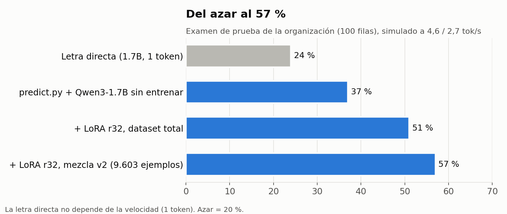

# La historia

Veintidós horas, del 14/11 a mediodía al 15/11 a mediodía: de un modelo que acertaba como una moneda al aire (21 %) a uno que, con el reloj de la placa, resuelve el 69 % del examen de prueba con el `predict.py` congelado a temperatura 0 (70 % con los reintentos a 0,7 que se quitaron por la regla 11.1) (el 80 % de los problemas de texto).

Esta página es el resumen. El cuaderno de laboratorio, hora a hora, está en [cronologia-detallada.md](cronologia-detallada.md).

## En cifras

| | |
|---|---|
| Problemas con opciones limpiadas | 4.379 de 4.862 (del 63 % al 90 %) |
| Explicaciones escritas para train | 3.684 |
| Formas de preguntar probadas | más de 40 |
| Modelos base comparados | 13 |
| Modelos entrenados | unos 30 |
| Exámenes registrados en la nube | 284 (más 49 de la primera campaña) |
| Problemas sintéticos verificados por ejecución | más de 15.000 |
| Máquinas alquiladas | 6 (1 RTX PRO 6000 de 96 GB, 1 RTX PRO 6000 Max-Q y 4 RTX 3090) |
| Del baseline al mejor sistema, en el examen de prueba | 21 % → 70 % |

---

## Acto 1 · Preparar el terreno (14/11, 14:00-17:10)

- **14:35 · OCR en la gráfica.** El OCR del reto leía 0,56 imágenes/s en CPU. CUDA no funcionaba en la RTX 5060 Ti (Blackwell) y caía a CPU sin avisar; con DirectML y 3 procesos se llegó a 7,4 imágenes/s. Las 4.862 imágenes se leyeron en 12 minutos.
- **14:48 · Primer susto.** El OCR solo encontró las cinco opciones en el **63 %** de los problemas. Y el script oficial escribía los `.jsonl` con finales de línea de Windows, que la placa no espera.
- **15:37 · La línea base: 21,5 %.** Los 789 problemas de val tardaron 68 s en la torre (en la placa serían unas 2 horas). Contestar siempre D da el 22,7 %. El modelo del reto contestó D 348 veces y C solo 7, y en los niveles 3 y 6 sacó menos que el azar.
- **15:40-16:58 · Limpieza de las opciones.** Un LLM con visión leyó las 1.747 imágenes en inglés, en paralelo. Se cruzó con el OCR de los tres idiomas y los desacuerdos tuvieron una segunda lectura independiente.
  - En cada pasada, el lector se equivocó en 7 de 1.747: copiaba las opciones del problema de al lado. La segunda lectura los cazó.
  - Resultado: **90 %** de problemas con opciones fiables y una auditoría de 60/60.
  - La nota del modelo del reto no se movió (21,0 %): ni miraba las opciones.
- **17:06 · Primera prueba a mano.** Con 12 problemas, el 0.8B acertó 6 con la letra directa, y 4 de esos 6 eran D. Razonando acertó 1: escribía en LaTeX, con cabeceras, y no llegaba a la respuesta en 350 tokens.

## Acto 2 · Buscar por dónde (14/11, 17:10-21:00)

- **17:39 · El buscador del reto no entiende catalán.** bge-small-en encuentra la versión inglesa de un problema catalán o castellano el 74 % de las veces; bge-m3, el **100 %** (508 de 508).
- **17:43 · Preguntar mejor no sirve.** Cinco formas de pedir la letra al 0.8B dieron entre el 17 % y el 21,8 %. Con las probabilidades corregidas, el reparto de letras queda uniforme y el acierto no se mueve: el modelo no prefiere la correcta.
- **18:13 · Resumen de la ronda.** RAG con 2 ejemplos: 25,3 % como mucho. Qwen3.5-2B Q8 razonando: **31 %**, pero en la mitad de los problemas no llega a contestar. *El cuello de botella es la disciplina, no el conocimiento.*
- **18:48-19:18 · Explicaciones como ejemplos.** Con 351 explicaciones cortas en el RAG, el 2B sube al 34,5 %, pero lo que más ayuda es el prompt corto, no los ejemplos. En texto saca un 43 %; con figura, un 28 %.
- **19:40 · Nace la idea clave: que el modelo escriba un programa.** El programa se ejecuta en milisegundos y su resultado se casa con las opciones. **Idea de Arnau:** guardar un programa ya verificado para cada problema de train. Un programa se puede comprobar solo, ejecutándolo.
- **20:11 · Test de 100 problemas.** Letra directa 23 %, razonar 40 %, programa con código verificado de 2 problemas parecidos **41 %**. En texto, el **50 %**.
- **20:56 · Código para todo train.** 766 de 853 programas de problemas de texto imprimen la opción correcta (90 %).

## Acto 3 · La nube (14/11, 21:00 - 15/11, 01:00)

- **21:21 · Primera máquina:** RTX PRO 6000 de 96 GB, 152 núcleos y 4 TB de RAM, a 1,34 $/h. Antes hubo dos intentos fallidos: la primera oferta desapareció y el `pip` de la imagen rechazaba instalar.
- **21:46 · Nueve LoRA a la vez** (0,8B, 1,7B y 2B × explicación, código y mixto) con la gráfica al 100 %. En la torre, un QLoRA de prueba del 1.7B en 55 minutos.
- **21:51 · La referencia buena: 35,5 % en los 789 de val** con Qwen3-1.7B (texto 46 %, figura 27 %). Los 200 de la muestra daban 42 %: era ruido de muestreo.
- **21:58 · Primer mapa de fallos (508).** En los problemas de texto, el 61 % de los fallos son de planteamiento. En los de figura, el 70 % necesitan ver la figura.
- **22:37 · La rejilla de variantes** sobre 349 problemas de texto: devolver el valor y casarlo con las opciones (no la letra) sube 5,7 puntos.
- **22:44 · Dato de la organización:** el test oculto **no trae imágenes**. Todo el esfuerzo pasa a los problemas de texto.
- **22:59 · Segunda máquina**, una RTX 3090 a 0,16 $/h para explorar con vLLM. **23:51 · Tercera**, otra 3090 a 0,17 $/h.
- **23:34 · Los techos.** Qwen3-4B-Instruct-2507: 49,5 % (texto 69 %). Qwen3-8B: 47 %. Ninguno cabe en 60 s en la placa.
- **23:57 · El hallazgo del tiempo.** Recortada a lo que cabe en 60 s, la mejor variante cae al **18,9 %**: con ~120 tokens el 1.7B no termina ni el programa ni el razonamiento. El reloj manda.
- **00:21 · Llega el examen de prueba** de la organización: 50 problemas de 2026 en inglés y catalán. El 1.7B saca el 54 % sin límite de tiempo y el 47 % con el tiempo estimado.
- **00:57 · `predict.py` completo: 58/100 en la torre** sin límite de tiempo.
- **00:59 · Cinco máquinas** para explorar todos los caminos a la vez.

## Acto 4 · La fábrica de datos (15/11, 01:00-03:00)

- **01:23 · Primera autodestilación (184 programas propios): nada.** Demasiados pocos datos.
- **01:36 · Primera oleada de problemas sintéticos:** 231 de 240 verificados (96 %).
- **01:41 · De los 100 programas del examen de prueba, 37 no casan.** 32 dan un valor que no es ninguna opción (fallo de planteamiento) y solo 5 son errores tontos.
- **02:03 · El primer entrenamiento que mejora lo que cabe en la placa.** El 1.7B afinado con 516 de sus propios programas correctos sube del 39-41 % al **47-50 %** en la cadena de placa.
- **02:06 · La clave de modelos abiertos del hackathon (Helmcode).** DeepSeek genera 3.868 problemas en 8 minutos. Qwen3.6 y Gemma4 son ilimitados. A partir de aquí, todo lo que fabrica o comprueba datos usa modelos abiertos.
- **02:20 · Idea de Arnau:** MathQA y AQuA-RAT, problemas públicos de opción múltiple con un valor numérico, encajan con la cadena «programa → valor → opción». El 1.7B escribe sus propios programas para 12.000 problemas y se quedan 4.606 que aciertan.
- **02:49 · El mejor de la noche: LoRA r32, 3 épocas, sobre el dataset total.** Cadena de placa: **52-56 %**, frente a 40-41 % de la base.
- **02:54 · Primeras medidas en la placa de verdad.** El 1.7B lee a 4,3-5,2 tokens/s y escribe a 2,7-2,8. Qwen3.5-2B va igual de rápido. Leer el primer problema sin caché cuesta 71-78 s.
- **02:58 · Mezcla v2 (9.603 ejemplos)**, entrenando en la RTX PRO 6000. **03:00 ·** Traducción al catalán de 3.000 sintéticos, porque en catalán se acierta 6-8 puntos menos.

## Acto 5 · Afinar para la placa (15/11, 03:00-05:00)

- **03:09 · Lo que enseñó el examen corto en la placa.** En el primer problema, el servidor tenía que leer en frío. El paso de «valor razonado» tiraba la caché. Y si se acababa el tiempo, salía siempre la misma letra. Arreglos: la letra primero, el corte al cerrar el bloque de código y el calentamiento esperando a `/health`.
- **03:26 · Simulación con la velocidad medida (4,6 / 2,7):** el 1.7B sin entrenar saca el 37 %, y con el LoRA r32, el **51 %**. Ningún problema pasa de 56 s.
- **03:59 · El 2B entrenado saca 53/100.** Empate con el 1.7B dentro del ruido. Se desempata con val: 80 frente a 86 de 246, a favor del 1.7B.
- **04:01 · Error en el detector de repetidos.** Encontraba 0 de 789. El número del problema al principio del enunciado cambia entre niveles. Corregido con `difflib`: **13 de 13**.
- **04:06 · GRPO descartado.** Mejora val en la nube (+3,7) pero no la cadena que cabe en la placa (50 frente a 51).
- **04:17 · Nuevo líder: 17b_lora32_v2.** **57/100** en el examen de prueba y 89/246 en val, a 4,6 / 2,7 tokens/s.
- **04:19 · Pistas descartadas.** Incluso escritas mirando el propio problema, suben solo 1 en total. La pista cambia el programa al azar.
- **04:29 · Mapa de errores del líder (178 fallos, 103 problemas distintos).**
  - 75 de 103 son de planteamiento: ignora una condición, cuenta dos veces los pares, invierte una relación.
  - No es el tiempo: con el doble de tiempo, los cortados aciertan 6 de 74.
  - Una pista «perfecta», escrita viendo el error, arregla 30 de 178. Es el techo de cualquier chuleta.
- **04:45 · Generación masiva dirigida a esos errores:** unas 900 peticiones a cuatro modelos abiertos, con ocho focos sacados del mapa de errores. Ver [datos](05-datos-y-entrenamiento.md).

## Acto 6 · La noche de las sopas (15/11, 05:00-12:00)

- **05:00 · Mezcla v3 (16.313 ejemplos):** v2 más 5.368 problemas generados para las 48 trampas que salieron del mapa de errores. Se entrena en seis máquinas a la vez; la sexta, otra RTX PRO 6000, se alquila para probar el ajuste completo.
- **05:00 · Reserva E.** Cuando las opciones no son números, el modelo afinado contestaba casi siempre A. En train la E es la más frecuente en esos casos: en val, esa vía pasa de 4 a 14 aciertos de 22.
- **05:05 · La primera sopa.** La media de los pesos de dos LoRA del mismo 1.7B (v2 con lr 1e-4 y con 2e-4) suma 162 en demo + val, frente a 154 del mejor suelto. Los programas que casan aciertan más: promediar quita errores de planteamiento.
- **05:45 · El vicio de las constantes.** El v3 suelto baja en val. Causa: escribe el triple de programas que acaban en `print(48)` sin calcular nada; esos programas aciertan el 31 % de las veces que casan, frente al 75 % de los que calculan. Venían de 289 ejemplos así en los datos. Arreglos: `predict.py` pide otro programa si el primero solo imprime una constante, y la v4 (17.904) y la v4b (19.984) salen limpias.
- **06:30-09:05 · Sopas cada vez más grandes**, siempre con la simulación de placa en demo + val:

| Sopa | Demo | Val texto | Suma |
|---|---|---|---|
| v2 + v2_lr2e4 | 58 | 104 | 162 |
| 2 × v2 + 2 × v3 | 60 | 107 | 167 |
| 2 × v3 + v4 | 69 | 108 | 177 |
| 2 × v3 + v4 + 2 × v4b | 67 | 113 | 180 |
| 7 modelos v3 y v4 | 67 | 116 | 183 |
| **10 modelos v3, v4 y v4b (sopa_z10)** | **70** | **115** | **185** |

- **07:15 · Programa también en los problemas con figura:** en la demo, de 2/20 a 4-6/20.
- **Lo que no sumó:** el ajuste completo (147-150), el 2B (149-150), el GRPO (tres intentos, igual o peor), el rango 64, el lr 5e-5, exagerar la media y quitar o añadir miembros a la sopa final.
- **Incidentes.** Dos sopas a la vez dejaron la torre sin RAM (se reescribió la sopa matriz a matriz: de 10 a 4,5 GB y de 5 a 1 minuto). A las 08:15 el disco D se llenó con las carpetas intermedias. A las 08:58 se acabó el saldo de vast.ai y las seis máquinas se pararon.
- **09:30 · Congelación:** `sopa_z10-Q8_0.gguf` y `predict.py`. Comprobación independiente en el val de texto en castellano (no usado para elegir): todos los afinados ~8 puntos por encima de la base y la sopa final no queda por debajo de ninguno.
- **09:45 · Regla 11.1 («temperature 0 and a fixed seed»).** Los reintentos iban a temperatura 0,7. Se quitan: 185 → 185, igual y algo más rápido.
- **10:00-11:50 · Pruebas del sistema congelado.** Problemas de muestra del reto 5/5 con el CSV oficial; 14 casos raros sin una sola caída; dos pasadas idénticas. Val completo (789): **37,1 %** (texto 45,6 %, figura sin imagen 30,3 %). Los 16 fallos de texto de la demo no son por tiempo: con 120 s se recupera 1. Un último LoRA entrenado en la propia torre con datos dirigidos a los fallos de la sopa final no la mejora (178).

## Lo que aprendimos

1. **En una CPU lenta, el tiempo es la métrica.** Una variante que acierta el 50 % sin límite puede quedarse en el 19 % con el reloj de la placa. Desde las 23:57 todo se mide con ese reloj.
2. **Un programa verificado vale más que una explicación.** Se comprueba solo, lo escribe un modelo pequeño en pocos tokens y entrenar con él no hace que el modelo deje de escribir código.
3. **El modelo sabe adónde ir; falla al plantear.** El RAG, las pistas y los ejemplos le dan el método, pero no lo ejecuta mejor. Lo que sí lo mueve es entrenarlo con miles de planteamientos correctos.
4. **Medir el instrumento antes que el modelo.** El detector de repetidos que no detectaba nada, las descargas cortadas y el servidor que leía en frío solo se vieron al medir cada pieza por separado.
5. **La demo no es val.** En el examen de prueba los problemas de texto salen 12 puntos más fáciles que en M3Kang. Por eso los candidatos se comparan en los dos.
6. **Promediar modelos buenos y distintos suma.** Diez LoRA del mismo 1.7B con datos, épocas, lr y semillas distintos, promediados, ganan 20 puntos de suma al mejor de ellos suelto, sin coste en la placa.
7. **Los datos enseñan también los vicios.** Un 2 % de programas que imprimían la respuesta sin calcular bastó para que el modelo lo copiara.
8. **Las reglas, al pie de la letra.** Temperatura 0 aunque la semilla fija ya diera determinismo; quitarlo no costó nada.
