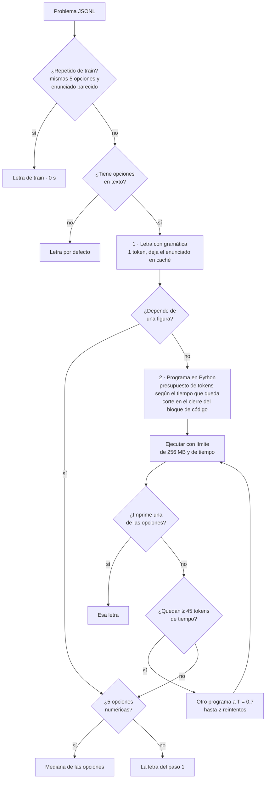
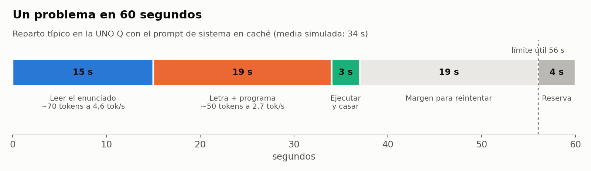

# El sistema que corre en la placa

Todo vive en un solo fichero, [`codigo/entrega/predict.py`](../codigo/entrega/predict.py) (también en `equipo/`, que es lo que se copia a la placa). Solo usa la biblioteca estándar de Python y habla con el `llama-server` oficial.

**La idea:** un modelo de 1,7B no sabe razonar en prosa en 60 s, pero sí sabe **traducir un enunciado a un programa de Python de 5-8 líneas**. El programa lo ejecuta la CPU en milisegundos y su resultado se casa con una de las cinco opciones. Cuando el programa casa con una opción, acierta el 90 % de las veces (47 de 52 en el examen de prueba con el modelo líder).

## La cadena



Cada paso existe por una medida concreta:

| Paso | Por qué |
|---|---|
| **Repetidos de train** | El Canguro repite problemas entre niveles. Con las mismas 5 opciones y un enunciado parecido (`difflib` ≥ 0,6, quitando el número del problema) contesta 13 de val y acierta los 13, en 2 ms y sin modelo de embeddings. |
| **Letra primero** | Cuesta 1 token, garantiza que siempre hay respuesta y deja el enunciado leído en la caché del servidor: el programa empieza sin volver a leerlo. Antes la letra iba al final y, si no daba tiempo, salía siempre la misma («C fija»). |
| **Programa corto** | El modelo escribe un programa que *calcula* (bucles para contar, probar casos, `Fraction`, `permutations`). Lleva un preludio con `math`, `itertools` y `fractions` ya importados, que recuperó 9 aciertos en val solo por errores de `NameError`. |
| **Corte en ```` ``` ```` ** | El servidor para en cuanto se cierra el bloque de código: no se pagan tokens de despedida. |
| **Reintentos a T = 0,7** | Los programas buenos son cortos y casi siempre sobra tiempo. Si el primero no casa, otro intento con temperatura gana unos 3 aciertos en el examen de prueba. |
| **Figuras a la reserva** | El examen no trae las imágenes. Pedir un programa en los problemas con figura no ganó ningún acierto y gastaba tiempo. |
| **Mediana** | En el Canguro la respuesta es el valor central de las cinco opciones el 30 % de las veces, y una de las tres centrales el 79 %. Es mejor reserva que la letra del modelo afinado, que sin razonar contesta casi siempre «A». |

## El presupuesto de tiempo



- **El prompt de sistema va en caché.** El servidor reaprovecha el prefijo común, así que cada problema solo lee sus 65-80 tokens nuevos. Sin caché lee unos 250 y el primer problema se va a 71-78 s. Por eso `predict.py` hace una petición de calentamiento al arrancar, esperando a que `/health` responda.
- **Un solo prompt de sistema para todo.** Cualquier petición con otro prompt de sistema tiraría la caché y el problema siguiente se leería en frío. Por eso se quitó el paso de «valor razonado»: en la placa nunca llegaba a entrar y solo ponía en riesgo la caché.
- **Velocidad medida al vuelo.** Arranca con las velocidades medidas en la placa (4,6 tokens/s leyendo y 2,7 escribiendo) y las corrige con los `timings` de cada respuesta del servidor. Con eso calcula cuántos tokens de programa caben en el tiempo que queda.
- **56 s útiles** de los 60, con margen para ejecutar, casar y escribir la fila.

## Robustez

- **Siempre escribe una fila.** Todo lo que puede fallar está dentro de `try/except`. Si algo explota, sale la reserva.
- **El programa del modelo no puede colgar la placa.** Se ejecuta en un subproceso con límite de 256 MB de memoria y de tiempo.
- **Un registro por problema.** Junto al CSV deja `<salida>.log.jsonl` con la letra, cada programa, lo que imprimió y por qué vía salió la respuesta.
- **Puerto oficial.** Lee el puerto de `config.env` del repositorio del reto (8081), o el que se le pase con `--url`.

## Uso

```bash
python3 predict.py --input problems.jsonl --output predictions.csv
# opciones: --url http://127.0.0.1:8081  --limite 56  --reserva mediana|letra|descarte
#           --tps-forzado 4.6,2.7  (simular la placa desde un PC rápido)
```

Salida: `id,language,answer,seconds,status`, con `status` igual a la vía (`duplicado`, `python`, `python2`, `mediana`, `letra`…).

## Cómo se simula la placa desde el PC

Medir en la placa cuesta 60 s por problema. Para comparar decenas de modelos, [`codigo/entrega/sim_demo.py`](../codigo/entrega/sim_demo.py) ejecuta el mismo `predict.py` en la torre con `--tps-forzado 4.6,2.7`: el modelo responde a la velocidad de la gráfica, pero el reloj se descuenta como si leyera y escribiera a la velocidad de la placa, contando la caché del prefijo. [`auto_sim.py`](../codigo/entrega/auto_sim.py) espera a que cada candidato termine de entrenar en la nube, baja su GGUF (en trozos de 200 MB con md5) y le pasa la simulación sobre el examen de prueba y sobre val.

## Despliegue en la placa

El sistema entero son dos piezas sobre el montaje oficial del reto:

| Pieza | Dónde | Cómo se pone |
|---|---|---|
| Modelo `sopa_z10-Q8_0.gguf` | `~/models/` | `LLM_FILE=sopa_z10-Q8_0.gguf` en el `config.env` del reto y `board/04_install_services.sh`, que regenera y reinicia `math-llm` con los ajustes oficiales (`--ctx-size 4096 --parallel 1 --cache-ram 0 --ctx-checkpoints 2 --jinja --reasoning off`) |
| `predict.py` del equipo | raíz del repo del reto | sustituye al `predict.py` oficial; lee el puerto de `config.env` (8081) y `data/train.jsonl` para el detector de repetidos |

[`instalar_en_placa.sh`](../instalar_en_placa.sh) hace las dos cosas, guarda los originales (`config.env.orig`, `predict_oficial.py`) y prueba N problemas por el servicio real, igual que lo ejecutará el jurado. `--deshacer` lo devuelve todo como estaba.

El servicio de embeddings (`math-embed`, bge-small) sigue arrancado porque el script oficial lo instala, pero nuestro `predict.py` no lo usa.
