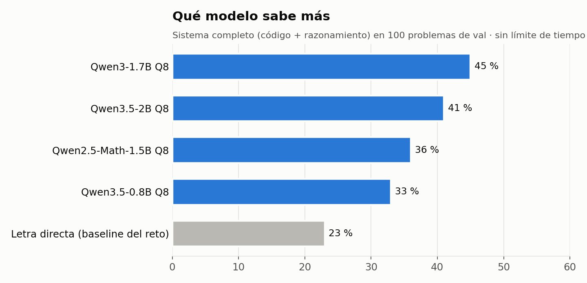
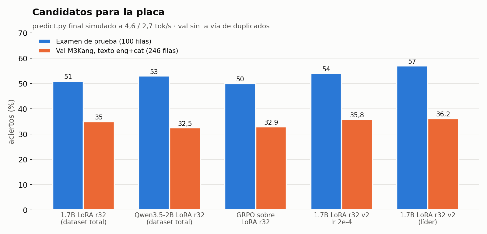

# Todos los modelos

En dos días pasaron por el proyecto **13 modelos base**, **2 de embeddings**, **5 generadores de datos** y **unos 30 modelos entrenados por el equipo**. Esta página los reúne con su mejor cifra y el motivo por el que siguieron o se quedaron fuera.

Leyenda de conjuntos de prueba:
- **val 789**: todo val de M3Kang (56 % con figura).
- **muestra 200 / T100**: subconjuntos fijos de val (200 con 112 de figura; 100 con 50 y 50).
- **val texto 349**: los problemas de val que se resuelven sin figura.
- **demo 100**: el examen de prueba de la organización (50 problemas × eng/cat).
- **simulación de placa**: `predict.py` final con el reloj de la placa (4,6 / 2,7 tokens/s).

Sin indicación, las cifras son sin límite de tiempo. Con 100 problemas el ruido es de unos ±5-7 puntos.

## Modelos base candidatos a ir en la placa

| Modelo | Q8_0 | Mejor resultado | Veredicto |
|---|---|---|---|
| **Qwen3-1.7B** | 1,8 GB | T100 **45 %** · muestra 200 42 % · demo 63 % (k0_valor) · simulación de placa 37 % | **Elegido.** El que más sabe de los que caben en tiempo. |
| Qwen3.5-2B | 2,1 GB | T100 41 % · razonando 31 % (muestra 200) · entrenado: simulación 53 % en demo | Empatado con el 1.7B dentro del ruido. Va igual de rápido en la placa (4,5 / 2,7). Plan B. |
| Qwen3.5-0.8B (el del reto) | 0,9 GB | T100 33 % · demo 33 % sin límite · ≤ 20 % en 60 s · letra directa 21 % | Descartado: no sabe resolver estos problemas aunque tenga tiempo. |
| Qwen2.5-Math-1.5B | 1,6 GB | T100 36 % · su código acierta 9/11 | Descartado: no sigue el formato y suelta la letra sin razonar (41 veces, 9 bien). |
| Qwen2.5-1.5B | — | demo 40 % · val texto 30,4 % | Descartado. |
| Qwen2.5-Coder-1.5B | — | demo 40 % (programa ≤150 → letra) · val texto 27,5 % | Descartado: buen código, peor planteamiento. |
| Qwen3-0.6B | — | demo 30 % · val texto 22,6 % | Descartado: rápido pero cerca del azar. |
| Gemma-3-1B | — | demo 25 % · val texto 21,2 % | Descartado. |
| SmolLM2-1.7B | — | demo 24 % · val texto 24,4 % | Descartado. |
| Qwen3-4B | — | muestra 200 **47 %** (texto 56 %) | Techo de referencia: no cabe en 60 s. |
| Qwen3-4B-Instruct-2507 | — | muestra 200 **49,5 %** (texto 69 %) · val texto **70,8 %** en bf16 | El que más sabe de todos. Según la estimación, leería un enunciado en ~35 s y escribiría a ~1,1 tokens/s: en 60 s solo cabe el 2-15 % de los problemas. |
| Qwen3.5-4B | — | muestra 200 45 % (texto 61 %) | Techo: no cabe. |
| Qwen3-8B | — | muestra 200 47 % (texto 60 %) | Techo: no cabe ni en los 4 GB de la placa. |

### Cuantizaciones

| Cuantización del 1.7B | Efecto |
|---|---|
| Q8_0 | Referencia. 1,8 GB. |
| Q4_K_M | **−5 a −7 puntos** (muestra 200: 36 % frente a 42 %). En la placa no lee más rápido. |
| Q4_0 | Medido en la placa: lee 4,5-5,2 y escribe 2,8 tokens/s, frente a 4,3 y 2,7 del Q8. Con el 2B, pasar a Q4_0 lee un 8 % más rápido y escribe igual. Solo ahorra memoria. |

En una Cortex-A53 sin instrucciones de producto escalar aceleradas, la velocidad cae casi en proporción al tamaño del modelo y bajar a 4 bits no compensa lo que se pierde.

### Pensar antes de escribir el programa

Qwen3 puede «pensar» antes de contestar. Dejarle 40, 80 o 150 tokens de pensamiento antes del programa dio igual o peor (demo 55-56 % frente a 58-63 % sin pensar) y duplica el tiempo. Se apaga con `--reasoning off`.

## Modelos de embeddings

| Modelo | Tamaño | Encuentra la versión inglesa de un problema en cat/esp | Uso |
|---|---|---|---|
| bge-small-en-v1.5 (el del reto) | 37 MB | 74 % a la primera, 86 % entre 3 | RAG del primer día |
| bge-m3 | 605 MB | **100 %** a la primera | RAG y detección de repetidos el 14/11. Retirado de la placa: 600 MB de RAM y sin mejora medible en acierto ([por qué](07-lo-que-no-funciono.md#rag-con-bge-m3)). |

La versión final no usa embeddings: los repetidos se detectan con `difflib` (13/13 en val, 2 ms).

## Generadores y profesores (fuera de la placa)

Modelos grandes usados para **fabricar datos**, nunca dentro de la placa:

| Modelo | Acceso | Para qué |
|---|---|---|
| Un LLM grande de API | API de pago | Limpiar las opciones leyendo las imágenes, explicar los 3.684 problemas de train, 244 programas verificados, 2.269 problemas sintéticos verificados, clasificar fallos |
| deepseek-v4-flash | Helmcode (clave del hackathon) | 3.868 problemas sintéticos en 8 minutos · profesor: el programa corto de cada problema de texto de train · doble verificación resolviendo a ciegas · diagnóstico de los fallos del líder · pistas |
| qwen3.6 | Helmcode, ilimitado | Problemas sintéticos · traducción al catalán de 3.000 sintéticos verificados |
| gemma4 | Helmcode, ilimitado | Problemas sintéticos, la mitad escritos en catalán |
| glm5.3-flash | Helmcode | Problemas sintéticos |

La clave de Helmcode del hackathon solo daba acceso a los modelos abiertos: los de la lista grande (glm5.3) y los comerciales respondían 402.

## Modelos entrenados por el equipo

### Primera campaña: ajuste fino con explicaciones (14/11, noche)

LoRA sobre 0,8B, 1,7B y 2B con tres datasets (explicaciones, código, mixto), examinados en la muestra de 200 con el sistema de entonces:

| Modelo | Sistema completo | Texto | Referencia sin entrenar |
|---|---|---|---|
| 17b_codigo | 36,0 % | 39/88 | 1.7B base: 42 % |
| 17b_explicacion | 36,0 % | 31/88 | |
| 17b_mixto_3ep_r32 | 30,5 % | 38/88 | |
| 17b_mixto | 27,5 % | 35/88 | |
| 2b_mixto | 34,0 % | 39/88 | 2B base razonando: 31 % |
| 2b_codigo | 33,0 % | 32/88 | |
| 2b_explicacion | 33,0 % | 34/88 | |
| 08b_mixto | 26,0 % | 32/88 | 0.8B base: 33 % (T100) |
| 08b_explicacion | 22,0 % | 22/88 | |
| local-17b_mixto (QLoRA 4 bits en la torre) | val texto k1_valor 40,1 % | | base 49,0 % |

**Todos peor que sin entrenar.** El modelo aprendía a explicar en prosa y dejaba de escribir código (programas en 109 problemas frente a 170 de la base), y la prosa acierta menos. Conclusión: con el 1.7B no se entrena con explicaciones.

### Segunda campaña: solo código, destilado y verificado (15/11, madrugada)

Todos sobre Qwen3-1.7B salvo los `2b_*`. En la nube se examinan con la cadena de placa (programa ≤150 tokens → letra o mediana); los finalistas pasan además por la simulación del `predict.py` final.

| Modelo | Receta | Demo, cadena de la nube | Simulación de placa (demo · val texto eng+cat) |
|---|---|---|---|
| auto (autodestilación 1) | 184 programas propios, LoRA r16 | igual que la base | — |
| auto2 (autodestilación 2) | 516 programas propios, LoRA r16, 3 épocas | **47 %** (base 39-41) | — |
| auto3 (autodestilación a escala) | 2.206 programas propios | 59 % (k0_valor) | — |
| 17b_full / 17b_full_3ep | ajuste completo, 2 y 3 épocas | 47 / 48 % | — |
| 17b_lora_total y variantes | LoRA r16, r64, lr 5e-5 sobre el dataset total | 47-53 % | — |
| **17b_lora32** | **LoRA r32, 3 épocas, dataset total** | 52-56 % | **51 · 86** |
| 17b_grpo | GRPO 200 pasos desde la base | 62 % (k0_valor, sin límite) | — |
| 17b_grpo_lora32 | GRPO encima de 17b_lora32 | 51 % | 50 · 81 |
| 2b_lora32 | Qwen3.5-2B, misma receta que 17b_lora32 | 53 % | 53 · 80 |
| pub (MathQA + AQuA-RAT) | 4.606 programas propios sobre problemas públicos | 59 % (k0_valor) | — |
| **17b_lora32_v2** | **LoRA r32, 3 épocas, mezcla v2 (9.603 ejemplos)** | **58 %** | **57 · 89 (líder)** |
| 17b_v2_lr2e4 | lo mismo con lr 2e-4 | 59 % (mediana) | 54 · 88 |
| 17b_v2_grpo | GRPO encima de v2 | 57 % (k0_valor) | en evaluación |
| 17b_v2_r32_4ep · 2b_v2r32 · 17b_v2_2ep | v2 a 4 épocas · 2B con v2 · v2 a 2 épocas | en entrenamiento | — |

Las cifras de val texto eng+cat son sobre 246 filas, sin contar los 4 que resuelve el detector de repetidos. El registro completo de cada examen está en [`pruebas/rejillas_nube.csv`](../pruebas/rejillas_nube.csv) y [`pruebas/simulaciones_placa.csv`](../pruebas/simulaciones_placa.csv).

