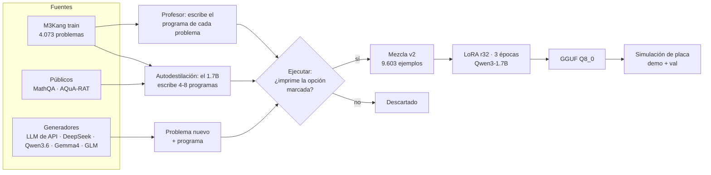

# Datos y entrenamiento

El modelo ganador no tiene nada especial: es Qwen3-1.7B con un LoRA. Lo especial son los **datos**. Son casi 10.000 problemas con un programa corto que los resuelve, y **cada programa se ha ejecutado** para comprobar que imprime la respuesta correcta.

## Limpieza de opciones

Antes de entrenar nada había que fiarse de los datos. El OCR del repositorio oficial solo leía bien las opciones del **63 %** de los problemas y dejaba basura pegada: «1 10», «15 2 10», fracciones `1/3` leídas como `13`, `√` como `V`.

- Las 1.747 imágenes en inglés se leyeron dos veces, de forma independiente, con un LLM con visión.
- Se cruzaron con el OCR de los tres idiomas y los casos dudosos se revisaron a mano.
- Resultado: opciones limpias en **4.379 de 4.862 problemas (90 %)**. El resto son opciones que son dibujos.
- Auditoría: 60 problemas al azar releídos por otro modelo, 60 iguales.

Las opciones limpias no cambian la nota del modelo del reto (21,5 % con las del OCR, 21,0 % con las limpias): el 0.8B ni las mira. Pero sin ellas no se puede verificar ningún programa.

## Explicaciones de todo train

Un LLM grande explicó los 3.684 problemas de train con 5 opciones: un máximo de 60 palabras en el idioma del problema, terminando en `Answer: X`, con una etiqueta de tipo y de confianza.

| | Problemas | Confianza alta |
|---|---|---|
| Solo texto | 1.925 | **95 %** |
| Con figura, viendo la imagen | 1.757 | **78 %** (sin verla, ~30 %) |

Unas veinte etiquetas de M3Kang contradicen la figura o el cálculo. Por ejemplo, el bloque `lvl-4_2022_*`, `lvl-2_2017_4`, `lvl-4_2018_8` y `lvl-5_2012_14`. Quedan apartadas en una lista de dudosas.

De ahí salieron los primeros datasets: `sft_explicacion` (3.037), `sft_codigo` (2.099) y `sft_mixto` (2.057). **El ajuste con explicaciones empeoró el modelo** (ver [modelos](04-modelos.md#primera-campaña-ajuste-fino-con-explicaciones-1411-noche)). Las explicaciones se quedaron como banco de pistas y para el análisis de errores.

## Programas verificados

La regla de oro de todos los datos de entrenamiento: **un ejemplo solo entra si su programa, ejecutado de verdad, imprime la opción marcada**.

| Fuente | Cómo | Ejemplos verificados |
|---|---|---|
| Código verificado de train | Un LLM grande escribe el programa; se ejecuta | 244 al principio (123 de 128 de texto correctos, 96 %), 1.728 en la mezcla v2 |
| Autodestilación | El propio 1.7B escribe 4-8 programas por problema a temperatura alta; se guardan los que aciertan, se quitan los comentarios | 184 → 516 → 2.206 → 3.950 |
| Problemas sintéticos (LLM de API) | 40 lotes de 60 problemas nuevos al estilo Canguro, con su programa | 2.269 (control independiente: 60/60) |
| Problemas sintéticos (Helmcode) | deepseek-v4-flash, qwen3.6, gemma4 y glm5.3-flash con el mismo prompt | deepseek: 3.868 en 8 minutos; en total, 8.120 sintéticos verificados en la mezcla v2 |
| Traducción al catalán | qwen3.6 traduce 3.000 sintéticos verificados con las mismas opciones y el mismo programa | en catalán acertábamos 6-8 puntos menos |
| MathQA + AQuA-RAT | El 1.7B escribe sus propios programas para 12.000 problemas públicos; se guardan los que casan | 4.606 |
| Profesor DeepSeek | El programa corto de cada problema de texto de M3Kang-train | `sft_profesor` |

Detalles que importaron:
- **Doble verificación**: DeepSeek resuelve a ciegas cada sintético y se descartan los que no coinciden, porque un programa puede ser coherente con una respuesta mal marcada.
- **Prompt del generador** ([`prompt_generador.txt`](../codigo/datos_sinteticos/prompt_generador.txt)): exige situaciones con una vuelta de tuerca, condiciones que se pasan por alto («al menos», «distintos», «cada lado», «en parejas»), distractores de los errores típicos y respuestas repartidas entre A y E. Pide además programas que *calculen*: nunca `print(42)`.
- **Mezcla v2**: 9.603 ejemplos sin duplicados (las fuentes suman más porque se solapan).

## Recetas de entrenamiento

Todo con [`entrenar.py`](../codigo/entrenamiento/entrenar.py) (transformers + peft) en bf16, y GRPO con trl.

| Receta | Parámetros | Resultado |
|---|---|---|
| **LoRA r32 (la ganadora)** | rango 32, alpha 64, dropout 0,05, todas las proyecciones (q, k, v, o, gate, up, down), lr 1e-4 coseno con 10 pasos de calentamiento, lote 4 × 4, 1.024 tokens, 3 épocas | Mezcla v2: **57 %** en la simulación de placa |
| LoRA r16 / r64 / lr 5e-5 / lr 2e-4 | Variaciones de la anterior | 47-54 %, dentro del ruido |
| Ajuste completo | Todos los pesos, 2 y 3 épocas | 47-48 % en la cadena de la nube |
| QLoRA 4 bits en la torre | RTX 5060 Ti, `sft_mixto`, 2 épocas, 55 min, pérdida 0,73 / 0,75 | −9 puntos (explicaciones) |
| GRPO | 8 programas por problema; recompensa +1 si imprime la opción correcta, −0,3 si casa con otra, 0 si no casa, y penalización suave por longitud; lr 1e-6, 150-400 pasos | Sin mejora en la cadena de placa (50 frente a 51) |

**Exportación** ([`exportar.sh`](../codigo/entrenamiento/exportar.sh)): se junta el LoRA con la base, se convierte a GGUF bf16 con el `convert_hf_to_gguf.py` de llama.cpp y se cuantiza a Q8_0. Es el mismo formato y el mismo motor que en la placa: lo que se examina en la nube es exactamente lo que se copia a la placa.

## Cómo se examina cada modelo

1. **En la nube, al acabar de entrenar** ([`trabajo_lora_total.sh`](../codigo/entrenamiento/trabajo_lora_total.sh)): `llama-server` con el GGUF y [`eval_variantes.py`](../codigo/evaluacion/eval_variantes.py) sobre la demo (100) y val texto (349). Cuenta el tiempo como si fuera la placa (3,8 / 2,5 tokens/s, la estimación pesimista) y prueba varias formas de preguntar.
2. **Los finalistas, en la torre** ([`auto_sim.py`](../codigo/entrega/auto_sim.py)): el `predict.py` final con el reloj de la placa medido (4,6 / 2,7) sobre la demo y sobre val en inglés y catalán (246 filas).
3. **El elegido, en la placa** con el [kit de velocidad](09-kit-de-velocidad.md).
