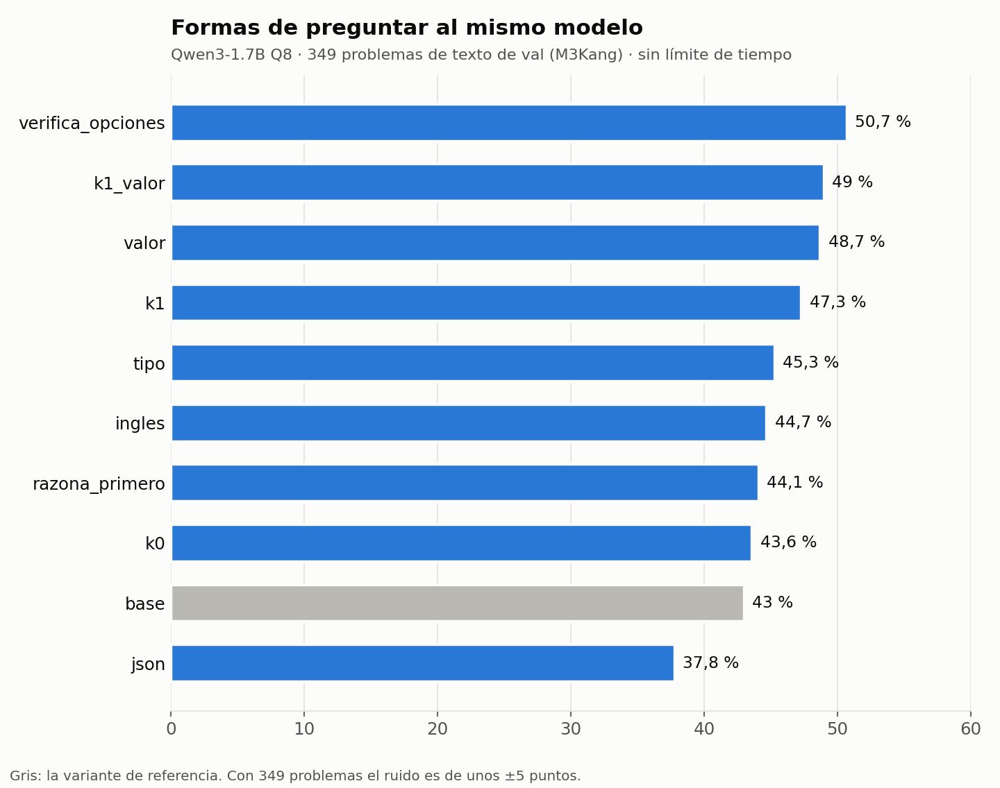
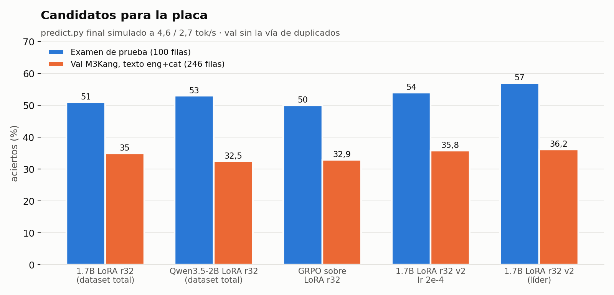
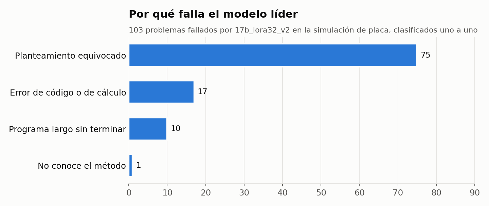

# Resultados

Todas las pruebas, en el orden en que se hicieron. Los datos crudos están en [`pruebas/`](../pruebas):

| Fichero | Qué tiene |
|---|---|
| [`rejillas_nube.csv`](../pruebas/rejillas_nube.csv) | 284 exámenes de las máquinas de la nube: modelo, conjunto, variante, aciertos, desglose por idioma, tiempo estimado en la placa, % que cabe en 60 s y vías |
| [`campana_ajuste_y_techos.csv`](../pruebas/campana_ajuste_y_techos.csv) | 49 exámenes de la primera campaña de ajuste fino y de los modelos grandes de referencia |
| [`simulaciones_placa.csv`](../pruebas/simulaciones_placa.csv) | 117 simulaciones del `predict.py` de cada candidato y cada sopa, a la velocidad medida en la placa (val con la vía de repetidos incluida) |
| [`lider_desglose.csv`](../pruebas/lider_desglose.csv) | El modelo líder por idioma, nivel, tipo y vía |

Sin indicación, todo se midió en la torre (RTX 5060 Ti) o en la nube con llama.cpp y GGUF, con los mismos parámetros que la placa (`--jinja --reasoning off`, temperatura 0, semilla 42).

**Ruido de muestreo** (intervalo aproximado al 95 %): ±7 puntos con 50 problemas, ±5 con 100, ±3,5 con 200, ±5 con 349 y ±3,5 con 789.

---

## 1. La línea base y las formas de pedir la letra

789 problemas de val, Qwen3.5-0.8B Q8 (el modelo del reto):

| Variante | Acierto | Letra más repetida |
|---|---|---|
| Oficial: `Answer:` + gramática [A-E], opciones del OCR | 21,5 % | D 348/789 |
| Oficial, opciones limpias | 21,0 % | D 500/789 |
| `The correct option is (` + gramática | 21,8 % | |
| La letra más probable (logprobs) | 21,0 % | |
| Logprobs con el sesgo por letra corregido | 20,7 % | reparto uniforme |
| Valor de la opción en vez de letra | 17,0 % | |
| Qwen3.5-2B Q4_0, letra directa | 22,2 % | B 571/789 |
| *Siempre D* | *22,7 %* | |
| *Azar* | *20 %* | |

## 2. RAG (0.8B, letra directa, 789)

| Ejemplos | bge-small-en | bge-m3 |
|---|---|---|
| 0 | 21,0 % | 21,0 % |
| 1 | 23,4 % | 24,2 % |
| 2 | **24,8 %** | **25,3 %** |
| 3 | 22,8 % | 23,8 % |

Calidad del buscador (508 problemas en catalán o castellano buscando su versión inglesa): bge-small-en 74 % a la primera y 86 % entre 3; **bge-m3 100 % y 100 %**.

## 3. Razonar en vez de soltar la letra (muestra de 200)

| Modelo | Máx. tokens | Acierto | Tokens de media (≈ s en la placa) | No llega a contestar |
|---|---|---|---|---|
| 0.8B Q8 | 400 | 23,5 % | 315 (63 s) | 127/200 |
| 2B Q4_0 | 400 | 28,5 % | 299 (60 s) | 127/200 |
| 2B Q4_0 | 1.200 | 29,5 % | 697 (139 s) | 103/200 |
| **2B Q8_0** | 400 | **31,0 %** | 267 (53 s) | 97/200 |
| 2B Q8, prompt corto (≤60 palabras) | | 34,5 % | 179 (36 s) | 73/200 |
| 2B Q8, prompt corto + RAG con 2 ejemplos explicados | | 34,0-34,5 % | 142 (28 s) | 42-46/200 |

## 4. Test de 100 (50 con figura y 50 de texto), 2B Q8

| Configuración | Total | Figura | Texto | Notas |
|---|---|---|---|---|
| A) Letra directa (como el reto) | 23 % | 24 % | 22 % | contesta C 43 veces |
| B) Razonamiento corto sin RAG | **40 %** | 40 % | 40 % | 184 tokens |
| C) RAG con 2 ejemplos explicados | 35 % | 32 % | 38 % | |
| D) Programa en Python con 2 ejemplos fijos | 35 % | 30 % | 40 % | código válido en 15/100 |
| E) Programa con el código verificado de 2 parecidos | **41 %** | 32 % | **50 %** | código válido en 25/100, que acierta el 60 % |

## 5. Comparativa de modelos con el sistema completo

T100 (los mismos 100 problemas):

| Modelo Q8 | Total | Figura | Texto | Tiempo estimado en la placa |
|---|---|---|---|---|
| **Qwen3-1.7B** | **45 %** | 44 % | 46 % | media 214 s (100/100 > 60 s) |
| Qwen3.5-2B | 41 % | 32 % | 50 % | media 122-155 s |
| Qwen2.5-Math-1.5B | 36 % | 26 % | 46 % | contesta la letra directa 41 veces |
| Qwen3.5-0.8B | 33 % | — | — | |

Muestra de 200, sistema sin reintentos ([`campana_ajuste_y_techos.csv`](../pruebas/campana_ajuste_y_techos.csv)):

| Modelo | Total | Figura | Texto |
|---|---|---|---|
| Qwen3-4B-Instruct-2507 Q8 | **49,5 %** | 38/112 | **61/88** |
| Qwen3-4B Q8 | 47,0 % | 45/112 | 49/88 |
| Qwen3-8B Q8 | 47,0 % | 41/112 | 53/88 |
| Qwen3.5-4B Q8 | 45,0 % | 36/112 | 54/88 |
| Qwen3-1.7B Q8 | 42,0 % | 38 % | 47 % |
| Qwen3-1.7B Q4_K_M | 36,0 % | 32/112 | 40/88 |

**Todo val (789), Qwen3-1.7B Q8, sistema completo: 35,5 %** (texto 46 %, figura 27 %). Vías: Python 92/150 (61 % cuando el código casa), razonamiento 182/607. Con el preludio de imports y el casador de unidades, la vía Python pasa de 92 a 101 aciertos.

## 6. Rejilla de variantes (349 problemas de texto de val, 1.7B Q8)

| Variante | Acierto | Tiempo en placa estimado (media) | Lectura |
|---|---|---|---|
| base (2 ejemplos de código + razonar) | 43,0 % | 212 s | referencia |
| k0 (sin ejemplos) | 43,6 % | 145 s | los ejemplos no dan precisión, solo cuestan tiempo |
| k1 (1 ejemplo, preludio y casador nuevos) | 47,3 % | 157 s | |
| tipo (ejemplos del mismo tipo) | 45,3 % | 205 s | |
| **valor** (el valor casado, no la letra) | **48,7 %** | 206 s | +5,7 y sin sesgo hacia la A |
| json | 37,8 % | 157 s | descartado |
| razona_primero (razonar y programar, prefiere si coinciden) | 44,1 % | 269 s | cuando coinciden aciertan el 76 % |
| ingles (reformular en inglés) | 44,7 % | 203 s | |
| k1_valor | 49,0 % | 161 s | |
| verifica_opciones (comprueba cada opción con `cumple(x)`) | **50,7 %** | 205 s | el comprobador decide en 17 y acierta 12 |
| *k0_valor recortado a 60 s* | *18,9 %* | *≤ 60 s* | *lo que cabe de verdad* |

## 7. El examen de prueba (demo 100)

1.7B Q8 en la torre, sin límite de tiempo salvo que se indique:

| Variante | Total | Texto | Figura | eng | cat | Cabe en 60 s |
|---|---|---|---|---|---|---|
| **k0_valor** | **63 %** | | | 70 % | 56 % | 50 % (a 6/3 tokens/s) |
| k1_valor | 54 % | 61 % | 25 % | 58 % | 50 % | 30 % |
| valor (k2) | 53 % | 62 % | 15 % | 58 % | 48 % | 7 % |
| verifica_opciones | 56 % | | | | | |
| valor200 (≤200 tokens, sin código) | 47 % | 54 % | 20 % | 50 % | 44 % | 84 % |
| Letra directa | 24 % | | | | | 100 % |

0.8B Q8 con las velocidades de la placa (10,6 / 5,8): 33 % en el mejor caso sin límite, y como mucho 20 % en lo que cabe en 60 s.

**Cadena de placa** (1.7B Q8, 3,8 / 2,5 tokens/s, prefijo en caché):

| Variante | Total | El programa casa → acierta | Cabe en 60 s |
|---|---|---|---|
| codigo80_letra | 34 % | 28 → 18 | 32 % |
| codigo110_letra | 36 % | 37 → 24 | 37 % |
| codigo150_letra | 41 % | 40 → 30 (75 %) | 38 % |
| codigo220_letra | 39 % | 38 → 27 | 37 % |
| **codigo150_mediana** | **45 %** | 42 → 31 | 68 % |
| Sin comentarios (`logit_bias` contra `#`) | 30-32 % | | |

## 8. Simulación del `predict.py` final (4,6 / 2,7 tokens/s)

| Modelo | Demo | Texto demo | Val texto eng+cat, sin repetidos | Media / máx. | Programa casa → acierta (demo) |
|---|---|---|---|---|---|
| Qwen3-1.7B sin entrenar | 37/100 | 32/80 | — | 37 / 52 s | 25 → 21 |
| 17b_lora32 | 51/100 | 49/80 | 86/246 | 34 / 52 s | 45 → 37 |
| 17b_lora32 a 4,0 / 2,4 tokens/s | 46/100 | 44/80 | — | 36 / 52 s | 43 → 35 |
| 2b_lora32 | 53/100 | 51/80 | 80/246 | 36 / 52 s | 40 → 37 |
| 17b_grpo_lora32 | 50/100 | 48/80 | 81/246 | 34 / 52 s | 43 → 36 |
| 17b_v2_lr2e4 | 54/100 | 52/80 | 88/246 | 34 / 52 s | 54 → 45 |
| **17b_lora32_v2 (líder)** | **57/100** | **55/80** | **89/246** | 34 / 52 s (val: 43 / 58 s) | **52 → 47** |

## Análisis de errores

Lo que pide el reto: errores por tema, idioma y dificultad.

### Por tema (1.7B, 349 problemas de texto de val, tipo según el vecino de train)

| Tema | Acierto |
|---|---|
| Probabilidad | 71 % |
| Aritmética | 52 % |
| Teoría de números | 49 % |
| Conteo | 47 % |
| Álgebra | 44 % |
| Geometría (sin figura) | 42 % |
| Medida | 38 % |
| **Lógica** | **27 %** |

Por longitud del enunciado: **menos de 40 palabras, 61 %**; entre 40 y 80, 33 %; más de 80, 38 %. Con opciones numéricas, 47 %; con opciones de texto, 40 %.

### Por idioma

| | Inglés | Catalán | Castellano |
|---|---|---|---|
| Baseline (0.8B, letra, 789) | 22,1 % | 23,8 % | 18,1 % |
| 1.7B, rejilla base (349 de texto) | 46 % | 40 % | 43 % |
| Líder, demo (simulación de placa) | **60 %** | **54 %** | — |
| Líder, val texto (simulación de placa) | **42,3 %** | **33,3 %** | — |

Con el líder de la madrugada, en catalán se perdían **6-9 puntos**; con el modelo final, 6-14 en la demo y 6 en val. Por eso la generación masiva lleva un 40 % de problemas en catalán y un foco solo en catalán.

### Por nivel (líder, simulación de placa)

| Nivel | 0 | 1 | 2 | 3 | 4 | 5 | 6 | 7 |
|---|---|---|---|---|---|---|---|---|
| Demo | 12/16 | 8/16 | 7/14 | 4/12 | 7/12 | 5/10 | 5/10 | 9/10 |
| Val texto eng+cat | 4/8 | 3/8 | 1/12 | 7/12 | 21/58 | 19/60 | 22/54 | 16/34 |

La dificultad no crece de forma limpia con el nivel. Los niveles altos tienen más problemas «calculables» (álgebra, teoría de números) que el programa resuelve bien. Los bajos tienen más lógica y lectura literal.

### Por causa

**Primer mapa** (1.7B base, 508 fallos de val, clasificados uno a uno):
- **Texto (188 fallos):** planteamiento 61 %, cálculo 11 %, sesgo de letra 11 % (programas que imprimen una constante), error de código 7 %, cortado 3 %, casado de opciones 3 % («22,5 km/h», «2,80 €», «30 %»), etiqueta dudosa 3 %.
- **Figura (320 fallos):** 70 % necesitan la figura sí o sí, 19 % planteamiento.

**Mapa del líder** (17b_lora32_v2, 178 fallos de texto de demo y val, 103 problemas distintos):

| Cómo falla | Filas |
|---|---|
| El programa casa con OTRA opción | 48 |
| Da un número que no es ninguna opción | 46 |
| Sin salida (48 cortados sin `print`, 20 con `print` que no imprime) | 68 |
| Texto que no casa | 10 |
| Sin tiempo | 6 |

- **No es el tiempo.** Los 74 problemas cortados o sin tiempo, con el doble de tiempo (120 s), aciertan 6.
- **Es el planteamiento.** Ignora una condición, cuenta los pares ordenados dos veces, invierte una relación o confunde «antes» con «después». 48 de los 103 tienen una lección genérica, como «count unordered pairs once», «enforce total value constraint» o «strictly after».
- **Techo de cualquier chuleta.** Una pista escrita viendo la respuesta y el error exacto (≤10 palabras) arregla 30 de 178: 28 de 126 de planteamiento, 2 de 32 de código y 0 de 19 largos. Una pista recuperada automáticamente daría mucho menos y rompería aciertos.

Esas lecciones son la semilla de la generación dirigida de datos: problemas nuevos en los que la trampa decide la respuesta, con un programa que la evita explícitamente.

## 9. Comprobación independiente (castellano, 103 filas que no se usaron para elegir)

| Modelo | Aciertos |
|---|---|
| Qwen3-1.7B base | 34 |
| 17b_v3 | 41 |
| **sopa_z10 (modelo final)** | **42** |
| sopa_z7 | 42 |
| 17b_lora32_v2 | 43 |

Los modelos ajustados sacan unos 8 puntos más que la base y empatan entre sí. Ningún problema pasa de 52 s simulados.
