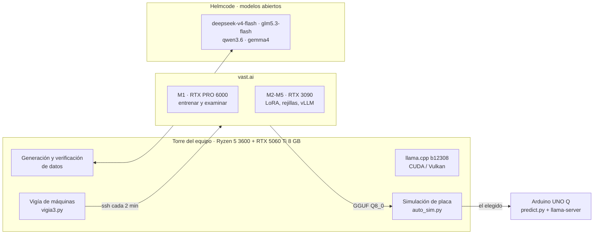

# Infraestructura

Tres sitios donde se calcula y uno donde se decide:

## La torre

- **Ryzen 5 3600, 32 GB de RAM, RTX 5060 Ti de 8 GB** (Blackwell). En esta gráfica, CUDA fallaba en el OCR (cuDNN) y se usó DirectML; llama.cpp sí funciona con CUDA.
- llama.cpp b12308 para Windows (CUDA y Vulkan). Es el commit justo anterior al del reto: el `2cbe0ec` no tenía binario publicado, y la diferencia es un arreglo del servidor web.
- Servidores locales con los mismos parámetros que la placa (`--jinja --reasoning off --reasoning-budget 0`): 1.7B, 0.8B y bge-m3, cada uno en su puerto.
- La torre no entrena (salvo la prueba de QLoRA de 55 minutos). Simula la placa, vigila la nube y fabrica y verifica los datos.

## La nube (vast.ai)

| Máquina | Gráfica | Dónde | $/h | Para qué |
|---|---|---|---|---|
| Primera (14/11, 21:21) | RTX PRO 6000, 96 GB, 152 núcleos, 4 TB de RAM | India | 1,34 | 9 LoRA a la vez, rejilla de variantes, techos con 4B y 8B, ajuste completo. Devuelta al terminar la campaña. |
| M1 | RTX PRO 6000 Max-Q, 96 GB | Canadá | 1,57 | Ajuste completo, LoRA r32 sobre las mezclas, GRPO; hasta tres entrenamientos a la vez |
| M2 | RTX 3090, 24 GB | México | 0,16-0,20 | vLLM para explorar variantes rápido; autodestilación sobre MathQA y AQuA |
| M3 | RTX 3090 | China | 0,17-0,26 | Cuantizaciones Q4/Q6/Q8, variantes de LoRA |
| M4 | RTX 3090 | China | 0,17-0,26 | Otros modelos base (Gemma-3, SmolLM2, Qwen2.5…), Qwen3.5-2B |
| M5 | RTX 3090 | China | 0,15-0,24 | Autodestilación a escala, pensar antes del programa, LoRA de 4 épocas |

**Explorar con vLLM, decidir con llama.cpp.** vLLM en bf16 con 64 peticiones a la vez examina una variante en 1-2 minutos, frente a 10-20 con llama.cpp. Pero solo llama.cpp con el GGUF Q8 reproduce lo que pasa en la placa, así que toda decisión final se mide con llama.cpp.

### El vigía

[`vigia3.py`](../codigo/nube/vigia3.py) mira cada máquina por ssh cada 2 minutos: uso de la gráfica, procesos de trabajo y la última línea de su `ESTADO`. Además:
- Apunta los resultados nuevos en `estado_maquinas.log`.
- Si una máquina lleva dos lecturas sin trabajo, **lanza la siguiente línea de su cola** (`cola_M<n>.txt`), porque una gráfica alquilada parada es dinero tirado.
- Cuenta como trabajo los entrenamientos, los exámenes, la exportación, el GRPO y las cadenas encadenadas. Una espera sin gráfica no cuenta como «parada».

### Cosas que se rompieron

- **`pip` en la imagen de PyTorch 2.11:** Python «gestionado» que rechaza instalar sin `--break-system-packages`. En otra máquina, el venv no traía pip.
- **`pkill -f` con un patrón que también aparecía en la propia línea de ssh:** el comando se mataba a sí mismo. Los trabajos se lanzan con `setsid nohup` y se paran por PID.
- **Descargas cortadas desde M4:** el enlace cortaba los `scp` largos y llegaban GGUF truncados. Ahora se baja en trozos de 200 MB con md5 y reintento.
- **Un servidor de examen que arrancaba en un puerto y se esperaba en otro:** la máquina más cara se quedó parada hasta que se vio en el registro.
- **El vigía tenía duración fija** (40 minutos) y se cerró solo con dos máquinas sin cola. Ahora corre 10 horas.

## Helmcode

La organización del hackathon dio una clave para modelos abiertos alojados en la UE, con una API compatible con OpenAI ([`helmcode.py`](../codigo/datos_sinteticos/helmcode.py)).

| Modelo | Cupo | Uso |
|---|---|---|
| qwen3.6, gemma4 | ilimitados | generación, traducción y resolución a ciegas |
| deepseek-v4-flash, glm5.3-flash | cupo mensual de la organización | generación, profesor, diagnóstico de fallos |
| glm5.3 y modelos comerciales | no incluidos (402) | — |

Límites de la clave: 100 peticiones por minuto, 5 a la vez por modelo (10 en los dos «flash») y 2 M de tokens por minuto. La clave es compartida, así que los clientes reintentan con espera exponencial ante un 429.

**Nada de Helmcode corre en la placa**: no hay red durante el examen y estos modelos tienen entre 35.000 y 744.000 millones de parámetros. Sirven para **fabricar** el modelo, no para estar dentro.

## Coste

Las gráficas alquiladas cuestan entre 0,15 y 1,57 $/h. En el momento de más trabajo había seis a la vez, unos 2,5 $/h en total. El plan es apagarlas en cuanto se elija el modelo final.
