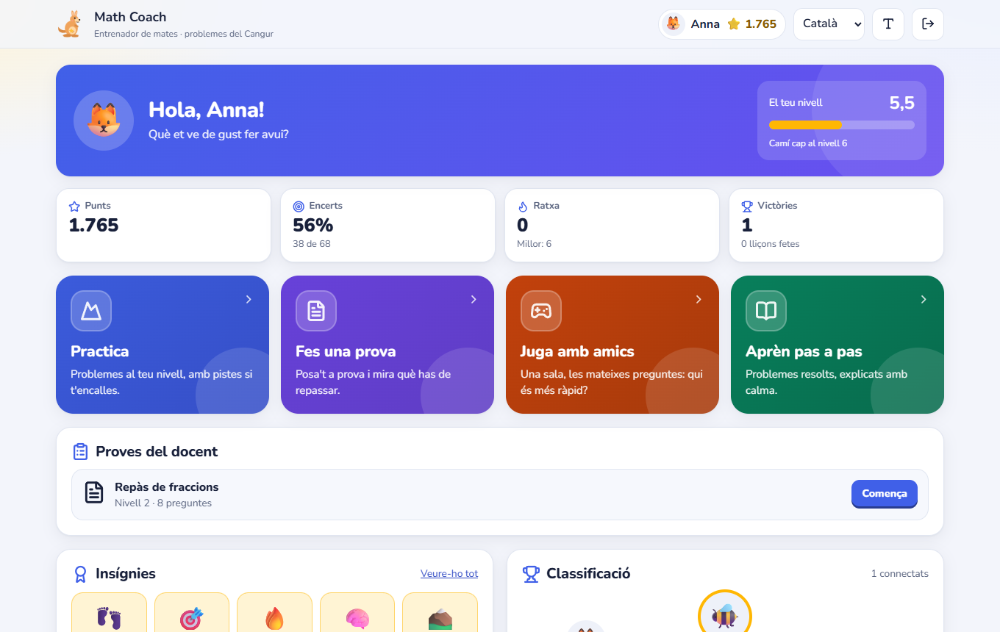
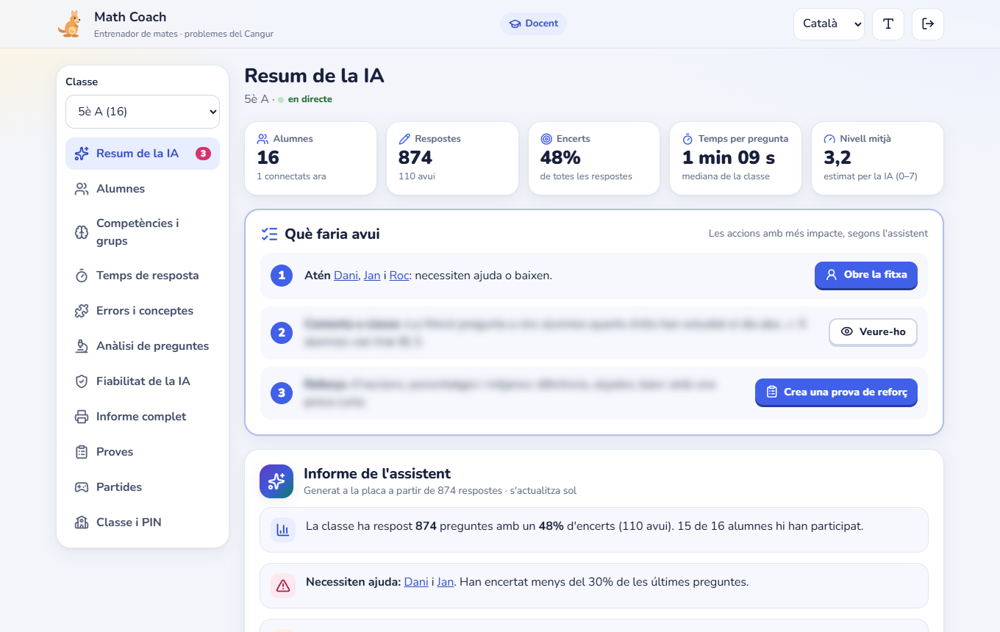
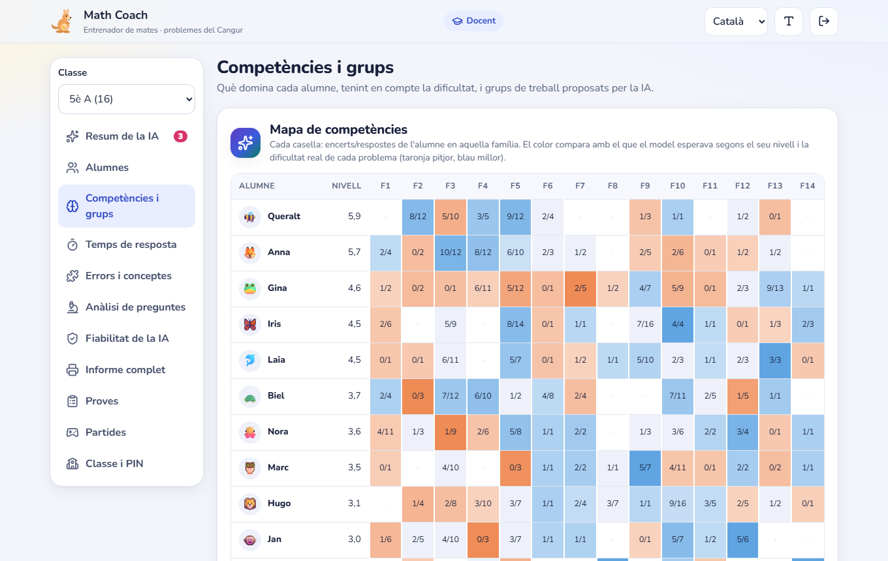
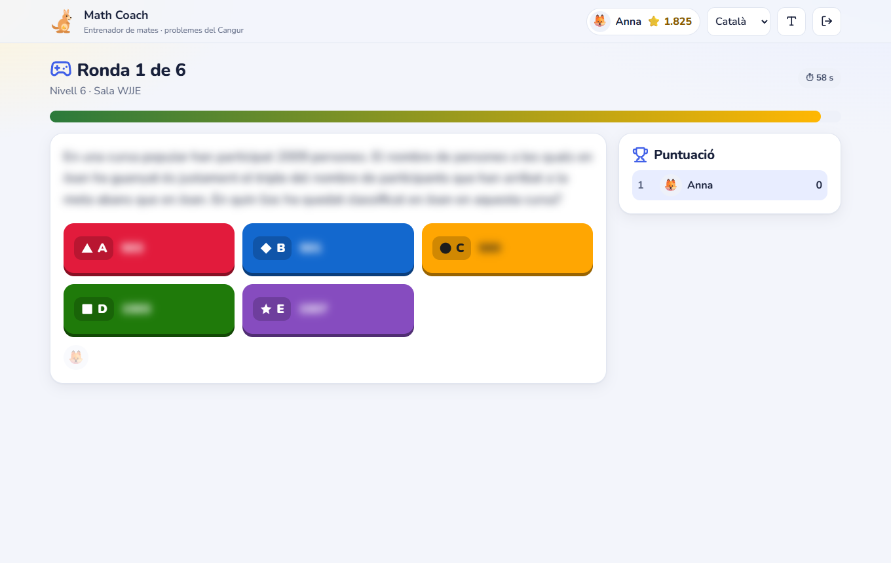
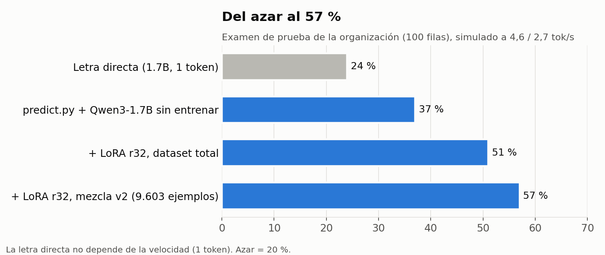

# A math copilot that thinks in Python, fully offline on the Arduino UNO Q

*Offline copy of our Arduino Project Hub write-up (submitted on 15/11/2026, waiting for moderation). Team Impostors: Arnau, Biel, Júlia and Carla · Datathon FME 2026, Qualcomm challenge "Math on the Edge".*

**A fine-tuned Qwen3-1.7B writes short Python programs to solve Math Kangaroo problems inside the UNO Q, offline and under 60 s, and a classroom app turns it into a hint ladder that never gives the answer away.**

| | |
|---|---|
| Hardware | Arduino UNO Q 4 GB (the LED matrix is the only extra we use) |
| Software | Arduino App Lab, llama.cpp `2cbe0ec` (the challenge's version), Python standard library |
| Model | `sopa_z10-Q8_0.gguf` (1.83 GB), in the [`modelo-final` release](https://github.com/Arnau000z/placa-velocidad/releases) |
| Code | this repository: [`equipo/predict.py`](../equipo/predict.py) (exam), [`instalar_en_placa.sh`](../instalar_en_placa.sh) (installer), [`teach/`](../teach/README.md) (Math Coach app) |
| Tags · level · licence | Edge AI, Embedded, Kids · Advanced · MIT |



## The idea

Math Kangaroo problems are five-option multiple choice (A-E) and are meant to be solved by reasoning. The Datathon FME 2026 Qualcomm challenge "Math on the Edge" asked for a math copilot that runs **entirely on an Arduino UNO Q**, offline, with 60 seconds per problem, that can both **Reason** (choose the right answer on a hidden test) and **Teach** (guide a student without giving the answer away).

The board's CPU reads about 4.6 tokens per second and writes 2.7. A minute is not enough for a prose explanation, and the challenge's baseline model answers 21% of our practice exam right: the same as chance.

Our answer: **the model doesn't reason in prose, it writes a five-line Python program**. The board runs it in milliseconds and the result is matched against the five options. With a model trained for exactly that, the system answers **69%** of the organisers' practice exam with the board's clock, and the same model powers a classroom app on the same board.

## Reason: a model that thinks in Python

Everything runs on the Linux side of the board (Qualcomm QRB2210, 4x Cortex-A53) as the official llama.cpp service. For each problem, `predict.py` (one file, Python standard library only):

1. **Repeated?** If the problem is already in the training bank with the same options, it answers in 2 ms.
2. **Quick letter.** The model gives a letter in 1 token, so there is always an answer, and the statement stays in the server's cache.
3. **Program.** The model writes a short program; its token budget adapts to the time left.
4. **Run and match.** A sandboxed subprocess (memory and time limits) runs it, and its output is matched against the options: numbers, fractions, units and text.
5. **Fallback** if nothing matches.

Two details matter a lot: the system prompt is always the same, so the server reuses it and each problem only reads its ~70 new tokens (without the cache the first problem takes 71-78 s); and temperature 0 with a fixed seed, so answers are reproducible.

### The training

Almost 20,000 problems with their program, and **every program was executed to check it prints the marked answer**: verified programs for M3Kang text problems, correct programs written by the model itself, synthetic problems from open models targeted at its failures (logic, long statements, Catalan) and public datasets (MathQA, AQuA-RAT). We trained rank-32 LoRA adapters on Qwen3-1.7B. The final model, `sopa_z10`, is the **average of the weights of 10 of them** ("model soup"), exported to GGUF Q8_0 (1.83 GB).

## Teach: Math Coach, a classroom platform on the board

The same board serves an App Lab app (port 7000) to the classroom's phones and laptops over Wi-Fi. Each student practises Kangaroo problems at their level with a **hint ladder that never gives the answer away**:

1. a similar, easier problem that is already solved, retrieved from a map of 810 M3Kang problems (bge-m3 embeddings grouped into 24 semantic families);
2. the topic and the method;
3. one sentence from the language model (the same `sopa_z10` as the exam), rejected by code if it reveals the answer;
4. the solution, only if the student asks for it.

Students simply **connect with their phones** to the board's web page to practise, take tests and play live class games, and the **LED matrix** reacts instantly with a tick or a cross and the student's level (checked on the board on 15/11), and the teacher gets a skills map of the class by topic and level. A small bridge lets the App Lab container reach the language model on 127.0.0.1 without exposing it to the network, so **a single model is loaded for everything** (about 2.4 GB of RAM still free).

**For the teacher, an AI that reads the whole class, computed on the board.** With a PIN, the teacher sees the state of the class and of every student: "what I'd do today" (up to 4 actions with their button), who needs help, who may be guessing, misconceptions shared by several students, each student's real level and each problem's real difficulty for this class (item response theory updated with every answer), a skills map by problem family, AI working groups (k-means), pace profiles from response times, question analysis (which questions confuse strong students, what each wrong option attracts), live AI reliability and a printable report. Report sentences and alerts are templates and transparent rules over these models, so they explain without inventing.



| Teaching check | Result |
|---|---|
| Hint 3 never gives the answer away (725 validation problems, 3 languages) | 6.3% of first attempts leaked it; **none reaches a student** after the checks |
| Hint 1 is a real hint (all 810 problems) | never the same answer value as the problem asked; same topic 53% |
| The trainer finds the student's level (simulated students) | students right below levels 2, 4 and 6 settle at 2, 4 and 6 |
| Several students at once (board) | answer + next problem in 50 ms |

| Teacher's skills map | Live class game |
|---|---|
|  |  |

More: [`teach/README.md`](../teach/README.md) and [`teach/app/math-coach/README.md`](../teach/app/math-coach/README.md).

## How we used M3Kang

- **Training factory:** verified programs for its text problems, and its problems as style references to generate new ones.
- **Map for teaching:** the problem families and the "easier neighbour" of the first hint.
- **Bank of repeats and test bench** for the error analysis.

M3Kang is licensed for research only, so none of its data is redistributed in the repository.

## Step by step

From a UNO Q with steps 0-10 of the [challenge repository](https://github.com/mpous/datathon-UPC-maths-qualcomm-arduino-unoq) done:

```bash
git clone https://github.com/Arnau000z/placa-velocidad.git ~/placa-velocidad
cd ~/placa-velocidad && ./instalar_en_placa.sh
```

The installer downloads the model from the repository release and checks its md5, points the challenge's `config.env` to it, reinstalls the official services, copies our `predict.py` and runs 6 problems through the real service with the real clock. The jury then runs:

```bash
cd ~/datathon-UPC-maths-qualcomm-arduino-unoq
python3 predict.py --input exam.jsonl --output answers.csv
```

For the Teach app: `bash teach/app/math-coach/deploy/install_on_board.sh` on the board, then open `http://<board-ip>:7000` from the same Wi-Fi. Before the exam, stop it (`arduino-app-cli app stop ~/ArduinoApps/math-coach`) so no hint competes with `predict.py` for the model.

## Results

Organisers' practice exam (50 problems in English and Catalan), with the board's clock:

| System | Accuracy |
|---|---|
| Chance | 20% |
| Challenge baseline (Qwen3.5-0.8B, direct letter) | 21% |
| Our system with untrained Qwen3-1.7B | 37% |
| With one LoRA trained on verified programs | 57% |
| **Final model (average of 10 LoRAs)** | **69%** |



Measured on the board itself (26 practice problems, real service and clock): **22/26, mean 36 s per problem, worst 54 s, none over 60 s**. On M3Kang validation (English and Catalan, text only, never used to choose the model): 116/242 (48%).

**Error analysis.**
- **By topic:** probability 71%, arithmetic 52%, number theory 49%, counting 47%, algebra 44%, geometry 42%, measurement 38%, logic 27%.
- **By language:** English 76% and Catalan 62% on the practice exam (51% and 45% on validation).
- **By level:** difficulty does not grow cleanly with the level: higher levels have more "computable" problems (algebra, number theory) that programs solve well; lower levels have more logic and literal reading.
- **By length:** statements under 40 words 61%, 40-80 words 33%.
- **By cause:** 75% of the errors are in the **setup** (a forgotten condition, pairs counted twice, an inverted relation), not in the arithmetic or the time.

Full tables: [docs/06-resultados.md](06-resultados.md).

## What we learned

- **On a board like this, time is the metric.** A variant that scores 50% without a limit drops to 19% with the board's clock, so we measured everything with that clock.
- **A verified program is worth more than an explanation.** Training on prose explanations made the model 9 points worse; training on executed, checked programs made it 20 points better.
- **RAG did not help the exam.** Similar solved examples in the prompt didn't raise accuracy and cost up to 65 s of reading per problem, but retrieval is exactly what makes the first hint of the Teach app useful.
- **Model soups work.** Averaging the weights of several runs beats the best single run.
- **Next:** teach the model to set problems up better, with data aimed at the typical Kangaroo traps.

---

Code, documentation and every test: <https://github.com/Arnau000z/placa-velocidad>. M3Kang: Torres-Camps et al., 2026, [arXiv:2601.16218](https://arxiv.org/abs/2601.16218).
