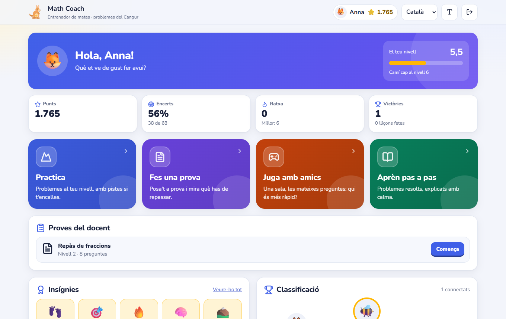
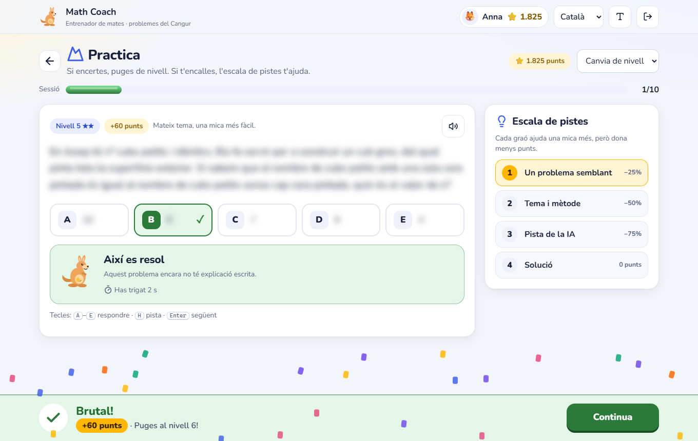
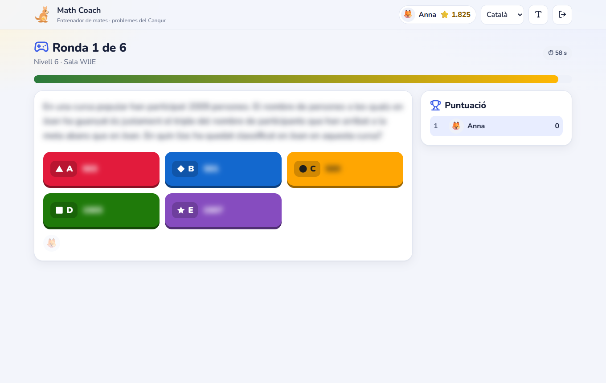
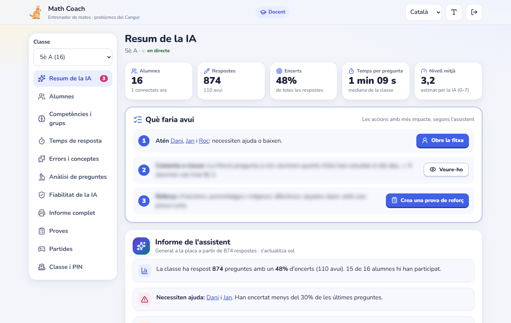
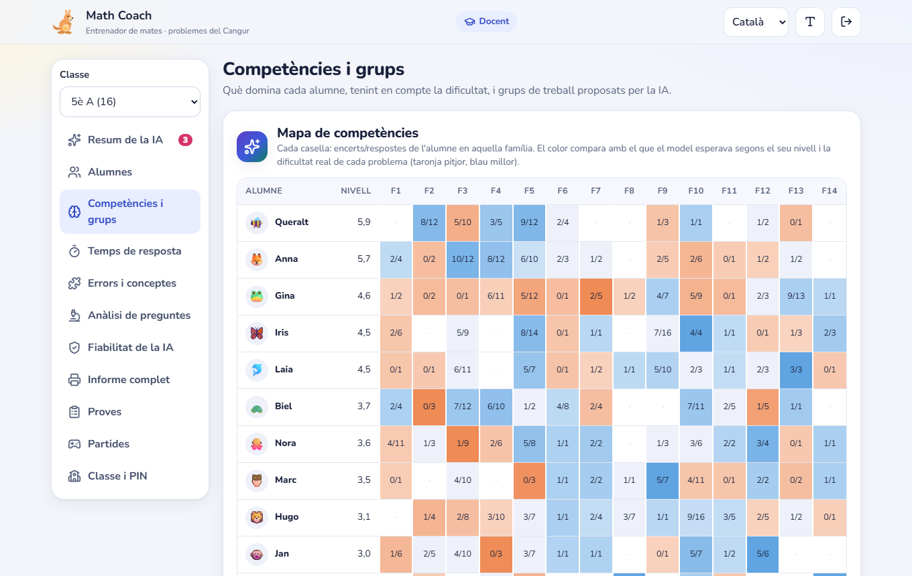
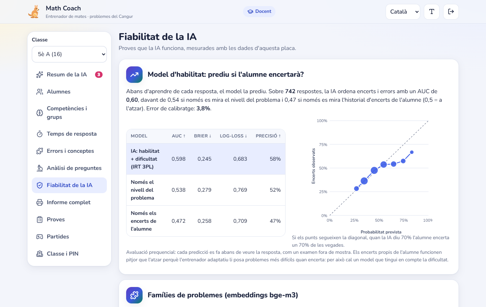
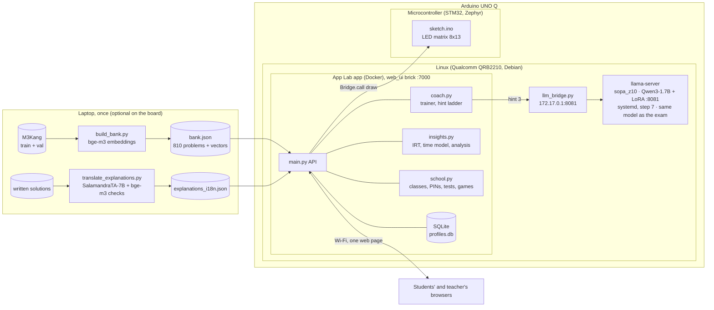

# Math Coach: a classroom maths platform with an AI assistant, entirely on the Arduino UNO Q

**Datathon FME 2026 · Qualcomm challenge "Math on the Edge" · track: Teach**

Math Coach turns one Arduino UNO Q into the maths platform of a whole class, with no internet. Students connect
to the board's Wi-Fi from any browser, pick their name and type a 4-digit PIN. They practise Kangaroo problems
(M3Kang) at their own level, with a **hint ladder that guides without giving the answer away**. They also take
tests, play **live games with friends** and **learn step by step** from solved problems, in Catalan, Spanish or
English. The teacher gets an **AI assistant computed on the board**. It shows each student's real level, a skills
map, working groups, response-time profiles, question analysis, risk alerts, "what I'd do today" and a printable
report, and backs every model with its own measured evidence. Nothing leaves the classroom.

| Student: home | Student: practice (Check, then Continue) | Live game with friends |
| --- | --- | --- |
|  |  |  |
| **Teacher: AI summary with today's actions** | **Teacher: skills map and AI groups** | **AI reliability, measured live** |
|  |  |  |

The problem text is blurred in the screenshots because M3Kang is for research use only. More screenshots are in
[`docs/screenshots/`](docs/screenshots/). The board also serves an explainer page for the jury at
`http://<board-ip>:7000/como-funciona.html` ([source](app/math-coach/assets/como-funciona.html)).
Screenshots of the student and teacher views are in [`docs/screenshots/`](docs/screenshots/).

## Contents

1. [What it does](#what-it-does)
2. [Architecture](#architecture)
3. [How to replicate it](#how-to-replicate-it-step-by-step)
4. [Results](#results)
5. [Error analysis](#error-analysis)
6. [What didn't work](#what-didnt-work)
7. [Team](#team) · [License and credits](#license-and-credits)

## What it does

**For students** (any phone, tablet or PC on the board's Wi-Fi):

- **Practise**: an adaptive trainer picks the next problem from a map of the problems. A right answer moves up a
  level, with a similar problem. A wrong answer moves down one level, staying on the same topic. If the student is
  stuck, a **4-rung hint ladder** helps:
  1. a similar, easier problem, already solved;
  2. the topic and its method;
  3. one sentence from the language model, checked so it never contains the answer;
  4. the solution.

  Each rung costs points. There is a session bar of 10 problems; the student picks an answer, presses **Check**, and
  gets the verdict and one **Continue** button.
- **Tests**: from the level the AI recommends, or set by the teacher. No hints; at the end, a review with every
  explanation and the families of problems to revise.
- **Play with friends**: a room with a 4-letter code and the same problem for everyone at once. Each answer has a
  colour and a shape. Points for right and fast answers, then a podium.
- **Learn step by step**: 396 solved problems, explained slowly: what are we asked, what do we know, which idea
  helps, guess first, then the solution one step at a time. They can be read aloud.
- **My progress**: the AI level, mastery per topic (Attempted, Familiar, Proficient, Mastered), the path of answers
  and 10 kinds of badges.

**For the teacher**:

- **AI summary**: "What I'd do today" lists up to 4 actions, each with its button. Below it, the assistant's report
  says who needs help, who may be guessing, the misconceptions shared by several students, suggested support groups,
  which topics take longest, and more.
- **Skills and groups**: a students × problem-families map adjusted for difficulty, AI working groups (k-means), and
  an explainable risk index.
- **Response time**: which topics make the class think hardest, and each student's pace profile.
- **Errors and concepts**: the families the class fails and the wrong answers shared by several students.
- **Question analysis** (psychometrics): which questions confuse the stronger students, and what each wrong option
  attracts.
- **AI reliability**: the evidence for every model (see [Results](#results)).
- **Full report**: everything in one printable document.
- **Tests, games, and class and PIN management** (printable PIN cards).

**Accessibility**:

- WCAG 2.2 AA contrast, measured for every colour pair.
- Targets of 44 px or more.
- 3 text sizes, high contrast, light and dark themes, fewer animations.
- Keyboard use, screen-reader live regions and read-aloud.
- Works on phones.

## Architecture



**On Linux**:

- The **language model** (our `sopa_z10`, Qwen3-1.7B + LoRA, Q8_0, llama.cpp: the same `math-llm` service that answers the exam, see the [main README](../README.md)) writes hint 3. The hint measurements below were taken earlier with Qwen3.5 0.8B.
- The **App Lab app** (Python in Docker, App Lab's `web_ui` brick on port 7000) serves the single-page web app and
  its API:
  - `coach.py`: the problem map, the adaptive trainer and the hint ladder with its leak checks;
  - `insights.py`: the teacher's AI;
  - `school.py`: classes, hashed PINs, tests, games and lessons;
  - SQLite: students' answers.
- App Lab containers can't reach `127.0.0.1` of the board. A tiny **bridge** (`board/llm_bridge.py`, a user service)
  relays `172.17.0.1:8081`, on the Docker interface only and never on Wi-Fi, to the model.

**On the microcontroller**: `sketch/sketch.ino` draws on the 8×13 LED matrix what Linux sends through the App Lab
Bridge (`Bridge.call("draw", ...)`): `?` and the level while a student answers, a tick or a cross after an answer, and
`...` while the model writes a hint.

**How we use M3Kang**:

- **A problem bank and difficulty scale.** 810 problems that need no figure and have 5 text options, in English,
  Catalan and Spanish. The official level (0–7) is the prior difficulty.
- **A map by meaning.** Each problem's bge-m3 embedding (1024 dimensions, computed once; the board stores only the
  vectors) gives:
  - the trainer's "nearest unseen problem";
  - hint 1 (the nearest easier solved problem, never a near-copy: Kangaroo reuses problems across levels);
  - 24 **semantic families** (spherical k-means) that the teacher's analysis is organised by.
- **The labels** give right or wrong answers, the ability model and the psychometrics.
- **Written solutions** (396, written for this project with the help of an AI assistant) feed the lessons, the
  feedback and hint 1. They are translated into Catalan and Spanish with verification.
- **A benchmark.** We first measured the "Reason" track (below); it showed that a 0.8B model can't be trusted to
  solve problems, which is why we built a teaching platform. In it the model is used only where its output can be
  checked. (The project's Reason part then fine-tuned a Qwen3-1.7B, `sopa_z10`, to 69% on the practice exam; that
  is the model the app uses on the final board. See the [main README](../README.md).)

**The teacher's AI** (`insights.py`, all computed on the board):

| Component | Type | What for |
| --- | --- | --- |
| Item response theory, 3PL with fixed 20% guessing, fitted online like Elo | Statistical learning, updated with every answer | Each student's real level and each problem's real difficulty for this class; success probability by level |
| bge-m3 embeddings + spherical k-means | Neural embeddings + unsupervised learning | Families of problems by meaning; similar problems for practice |
| Skills map + k-means (k chosen by silhouette) | Unsupervised learning | Difficulty-adjusted mastery per family; working groups |
| Log-normal response-time model | Statistical | "Slow" vs "hard": pace profiles (confident, thoughtful, stuck, impulsive, struggling) |
| Point-biserial discrimination, distractor levels | Classical psychometrics | Questions that confuse strong students; misconceptions |
| Report sentences, alerts, risk index | **Not AI**: templates and transparent rules over the models' outputs | Explain without inventing; every alert says why |

### Repository layout

| Path | What |
| --- | --- |
| `app/math-coach/` | **The App Lab app**: `app.yaml`, `sketch/`, `python/` (`main.py`, `coach.py`, `school.py`, `insights.py`), `assets/` (the web app, the font, the explainer page), `board/` (the model bridge and its service), `deploy/` (install scripts), `tools/` (measurements, demo data, translations), `build_bank.py`, `dev_server.py`, and [a detailed README](app/math-coach/README.md) |
| `config.env` | Pinned versions: llama.cpp commit; every model's repository, revision, file and SHA-256 (the team's **`sopa_z10`**, bge-small, **bge-m3**, **SalamandraTA-7B**); run settings |
| `board/` | Setup scripts and the `math-llm` / `math-embed` systemd services (from the organisers, setup steps 2–7) |
| `copilot/`, `eval.py`, `build_index.py`, `predict.py`, `make_variants.py` | The "Reason" pipeline, with the answer modes and RAG variants we added and measured |
| `docs/` | Screenshots and the full results tables |
| `SETUP.md` | The organisers' setup guide (steps 0–15), with our additions marked *(added)* |

## How to replicate it, step by step

Start from a board set up with **steps 0 to 12 of [SETUP.md](SETUP.md)**: llama.cpp built, the models of step 4
downloaded, the `math-llm` and `math-embed` services running (step 7), this repository on the board (step 8),
`data/train.jsonl` and `data/val.jsonl` copied to it (steps 9–10), and App Lab set up (step 0.1).

### 1. Get the code on the board

```bash
cd ~/<your clone of this repository> && git pull
```

### 2. Build the problem map (`app/math-coach/python/data/bank.json`)

The map needs the M3Kang files of step 10 (they are never committed: research use only). On the board, with the
embedding model pinned in `config.env`:

```bash
bash app/math-coach/deploy/get_models.sh bge-m3             # 0.63 GB into ~/models, checks the SHA-256
~/llama.cpp/build/bin/llama-server -m ~/models/bge-m3-q8_0.gguf --embedding --port 8084 \
    --ctx-size 8192 --batch-size 2048 --ubatch-size 2048 --parallel 1 &
EMBED_PORT=8084 EMBED_QUERY_PREFIX="" EMBED_MAX_CHARS=6000 EMBED_NAME=bge-m3 python3 app/math-coach/build_bank.py
kill %1                                                     # the embedding server is not needed any more
```

It ends with a summary: problems per topic, `With a written solution: 396` (0 without step 2b) and
`Languages: {'eng': 810, 'cat': 810, 'esp': 654}`. It writes `app/math-coach/python/data/bank.json`, 5.4 MB.
On a laptop GPU it takes 14 s, and then we copy the file to the board (`scp`). On the board it is slower, but we
haven't timed it.
**Quicker alternative:** use the `math-embed` service (bge-small, 384 dimensions) that is already running:
`python3 app/math-coach/build_bank.py`. The app adapts its thresholds to the model.

**2b. Written solutions (optional, before building the map)**: lessons, feedback and hint 1 show a written solution when
`data/explanations/*.jsonl` has one, one line per problem:
`{"id": "<problem id>", "explanation": "..."}`. Ours aren't published because they describe M3Kang problems.
Without them the app works, but the "Learn step by step" section is empty.

### 3. Optional: translate the written solutions (laptop with an NVIDIA GPU)

SalamandraTA-7B (4.85 GB) doesn't fit in the board's 4 GB of RAM, so this step runs once on a laptop. The full
commands and the 5 automatic checks are in [`app/math-coach/README.md`](app/math-coach/README.md#translations-of-the-written-solutions).
The result is `app/math-coach/python/data/explanations_i18n.json`. Copy it next to `bank.json`.

### 4. Install and start the app

On the board:

```bash
bash app/math-coach/deploy/install_on_board.sh
```

Or from a laptop (Linux, macOS or WSL):

```bash
bash app/math-coach/deploy/deploy_from_laptop.sh arduino@<board-ip>    # or: ... adb  (USB)
```

The script:
- copies the app to `~/ArduinoApps/math-coach`, keeping any class data already there;
- installs the model bridge as a user service (no sudo);
- starts the app with `arduino-app-cli`. The sketch compiles first, which takes about a minute.

It ends with:

```
Students and teacher:   http://<board-ip>:7000      (same Wi-Fi as the board)
How it works (jury):    http://<board-ip>:7000/como-funciona.html
Teacher PIN:            cat ~/ArduinoApps/math-coach/python/data/teacher_pin.txt   (created on the first start)
```

The LED matrix shows `?` and `0`. After a reboot, run `install_on_board.sh --restart`. If it warns about "linger",
run `sudo loginctl enable-linger $USER` once, so the bridge starts at boot.

### 5. First class

1. Open `http://<board-ip>:7000` and choose **Sóc docent / Soy docente / I'm the teacher**. Type the teacher PIN.
2. Go to **Class and PINs**: create a class, add students and print their **PIN cards**.
3. Each student opens the same address, picks their name and types their PIN.
4. In the student's **Practise**, answer a problem. The LED matrix shows a tick or a cross and the level.

### 6. Check it

```bash
python3 app/math-coach/tools/multi_user_test.py --url http://127.0.0.1:7000 --teacher-pin <pin>   # on the board
```

It creates a test class and simulates 4 students at once (rung 3 included). It reports the times and deletes the
class at the end.

### 7. Without a board (laptop demo)

```bash
python3 app/math-coach/tools/seed_demo.py --db app/math-coach/python/data/profiles-demo.db --force
python3 app/math-coach/dev_server.py --port 7100 --db app/math-coach/python/data/profiles-demo.db
```

Then open `http://127.0.0.1:7100`. The demo has 16 simulated students over 7 days; every student's PIN is 1234.

## Results

All figures were measured on 15 Nov 2026. The full tables are in [docs/results.md](docs/results.md).

### Teaching (our track)

| What | Result |
| --- | --- |
| **Hint 3 never gives the answer away** (725 validation problems, 3 languages, `tools/measure_hints.py`) | Attempt 1 gave the answer away 6.3% of the time and taught nothing (repeated the problem) 22.3% of the time. Rejected hints are retried; 6.8% fail twice, and the student then sees the topic's method. **Hints shown to students that contain the answer: 0** |
| **Hint 1 is a real hint** (all 810 problems, `tools/measure_ladder.py`) | Same answer value as the problem asked: 0. Same topic: 53%. With a written solution: 92% |
| **The trainer finds the student's level** (`tools/simulate_students.py`, 8 start levels × 20 runs × 40 steps) | Simulated students right below levels 2, 4 and 6 settle at 2, 4 and 6 |
| **The ability model predicts answers** (prequential: each answer is predicted before the model learns from it) | AUC 0.63, against 0.57 for the problem's level alone and 0.47 for the student's own running accuracy. Calibration error 4.2%. *Demo class, simulated (772 answers); on a real class the page shows live figures* |
| **Families group by meaning** (bge-m3) | Mean cosine 0.57 within a family vs 0.49 between families |
| **Translations are faithful** (SalamandraTA-7B + 5 checks) | 769 of 792 accepted (97.1%). Meaning (bge-m3): median 0.91 vs 0.51 for unrelated pairs |
| **Several students at once** (board, previous version, 4 in parallel) | Answer + next problem 50 ms; ranking 14 ms. Hint 3 is prefetched while the student reads hint 1 (0.0–0.1 s on 3 of 4 problems; 26 s when nobody prefetched) |
| **It fits on the board** (measured on the laptop; to confirm on the board) | App: 6.1 MB on disk, 65 MB of RAM. With the model: < 1 GB of 32 GB storage, ≈ 1.1 GB of 4 GB RAM |

### Reasoning experiments (`results/ablations.csv`) against the baseline

The same model, Qwen3.5 0.8B Q8_0, ran on the whole validation set (789 problems, 3 languages). We measured accuracy
on a laptop GPU for speed. Latency on the board is about 9 s per problem (SETUP.md, step 11.3).

| Run | RAG examples | Accuracy | vs baseline |
| --- | ---: | ---: | ---: |
| **Baseline**: one letter, grammar A–E | 0 | **21.3%** | |
| Answer with the option's value | 0 | 17.1% | −4.2 |
| One calculation line, then the letter (stopped at 717 problems) | 0 | 22.7% | +1.4 |
| RAG 1, bge-small, examples as letters | 1 | 23.1% | +1.8 |
| RAG 1, bge-small, examples as "C) 13" | 1 | 23.7% | +2.4 |
| RAG 1, bge-small, model answers with the value | 1 | 25.6% | +4.3 |
| RAG 3, bge-small | 3 | 25.6% | +4.3 |
| RAG 3, **bge-m3** (multilingual), plain examples | 3 | 26.9% | +5.6 |
| **RAG 3, bge-m3, examples with their value** | 3 | **27.2%** | **+5.9** |
| Levels 0–4 only: baseline | 0 | 26.5% | |
| Levels 0–4: RAG 3, bge-m3, examples with their value | 3 | 31.3% | +4.8 |
| **Levels 0–4: RAG 3, bge-m3, examples with a worked explanation** | 3 | **34.6%** | **+8.1** |

Always answering D, the most common answer, would score about 25%. The best setting beats the baseline by 6 to 8
points, but stays far from reliable. That is why the app never asks the model for answers.

## Error analysis

Validation set, baseline vs the best full run (bge-m3 RAG 3, examples with their value):

| By language | Baseline | Best | Problems |
| --- | ---: | ---: | ---: |
| English | 22.4% | 27.4% | 281 |
| Catalan | 21.4% | 28.5% | 281 |
| Spanish | 19.8% | 25.6% | 227 |

| By level | 0 | 1 | 2 | 3 | 4 | 5 | 6 | 7 |
| --- | ---: | ---: | ---: | ---: | ---: | ---: | ---: | ---: |
| Baseline | 38.2% | 34.0% | 29.5% | 8.6% | 23.0% | 21.5% | 10.9% | 15.6% |
| Best | 41.8% | 27.7% | 33.3% | 31.4% | 28.1% | 31.5% | 21.0% | 14.7% |
| Problems | 55 | 47 | 78 | 35 | 178 | 149 | 138 | 109 |

| By topic (the app's keyword topics) | Baseline | Best | Problems |
| --- | ---: | ---: | ---: |
| Lengths, areas and angles | 24.7% | 31.0% | 287 |
| Arithmetic and word problems | 20.6% | 29.4% | 160 |
| Digits and divisibility | 28.6% | 25.3% | 91 |
| Cubes, dice and solids | 15.6% | 12.2% | 90 |
| Fractions, percentages and averages | 9.8% | 43.9% | 41 |
| Counting and combinations | 22.2% | 48.1% | 27 |
| Speed and distance | 17.4% | 8.7% | 23 |
| Logic: who tells the truth | 0.0% | 16.7% | 18 |
| Ages / sequences / certainty / clocks | 13.3% / 40.0% / 0.0% / 18.2% | 13.3% / 13.3% / 0.0% / 45.5% | 15 / 15 / 11 / 11 |

What we read in it:

- **Letter bias.** The baseline answers D 511 times out of 789 (65%), while the true answers are spread evenly
  (132 to 179 per letter). With RAG examples the bias disappears (A 161, B 116, C 158, D 144, E 210). Most of the
  gain comes from breaking the bias, not from reasoning.
- **Difficulty.** Accuracy falls with the level. Levels 6–7 stay near chance (15–21%) in every setting.
- **Language.** There is no real gap. bge-m3 retrieves examples across languages, and Catalan gains the most (+7.1).
- **Topics.** RAG helps where a similar solved problem carries the method: fractions and percentages (+34) and
  counting (+26). It doesn't help, and even hurts, on spatial and procedural topics (cubes, speed, sequences), where
  the figure or a multi-step calculation matters. The small topics (11–18 problems) are uncertain.
- **Figures.** 440 of the 789 validation problems need their figure, which a text-only model never sees; this is why
  the app uses only the 810 text-only problems.
- **Hints by language** (rung 3, see [docs/results.md](docs/results.md)). Catalan hints most often taught nothing
  (30.5%, against 16.0% in English) and needed the second try. After the checks, 91–96% of the problems show a model
  hint in every language, and none shows the answer.

## What didn't work

- **Letting the model solve problems.** The best setting reached 27.2% overall and 34.6% on levels 0–4, too
  unreliable to tell a student whether they're right. We switched to the Teach track and use the labels instead.
- **Answering with the option's value** (17.1%), and **one line of calculation** (22.7%, three times slower).
- **The model writing the teacher's report.** The 0.8B model on the board didn't invent numbers, but it distorted
  facts (2 of 4 drafts, e.g. "Laia has prepared the class to go up a level") and mixed languages. The report is now
  generated from templates over computed facts, so it can't invent anything.
- **First-try hints.** 22.3% of the first hints just repeated the problem. A "teaches nothing" check and a second try
  fixed most of them; 6.8% still fall back to the topic's method.
- **Near-copies.** Kangaroo reuses problems across levels. Without an exclusion threshold (cosine 0.88 with bge-m3,
  0.95 with bge-small), hint 1 sometimes showed the same problem already solved.
- **The trainer at the bottom levels.** Levels 0 and 1 have only 29 and 27 text-only problems. Also, a student who
  is weak in one topic keeps sinking, because a wrong answer means "same topic, one level down".
- **Problems with figures.** They are excluded for now. Showing their images is the next step.
- **Translation edge cases.** 23 of 792 translations failed a check, mostly numbers written as words, and stay in
  English. One check counted the Catalan pronoun "es" as Spanish; we fixed it.
- **Hint 3 latency on the board.** It takes 26 s per hint, and up to 106 s when 4 students ask at once, because the
  model writes one hint at a time. Prefetching and a cache hide most of it.

## Team

Team Impostors (Datathon FME 2026): **Arnau, Biel, Júlia and Carla**. Exam track (Reason) and its model: see the [main README](../README.md).

## License and credits

- **Code**: the code written by our team is under the [MIT License](LICENSE). The organisers' files keep their
  terms, and the bundled third-party assets keep their own licences: the Nunito font (SIL OFL 1.1) and the Lucide
  icons (ISC). See [`app/math-coach/assets/THIRD-PARTY-LICENSES.txt`](app/math-coach/assets/THIRD-PARTY-LICENSES.txt).
- **M3Kang**: Torres-Camps et al., 2026, [arXiv:2601.16218](https://arxiv.org/abs/2601.16218), Qualcomm.
  [Dataset card](https://huggingface.co/datasets/qualcomm/M3Kang). It is for research use only, so **no M3Kang data is
  in this repository**: no `train.jsonl`, `val.jsonl`, images, `index.db`, `bank.json` or written solutions. Problems
  from the Kangaroo math competition.
- **Models**:
  - Qwen3-1.7B (Qwen team), base of our fine-tuned `sopa_z10`, and Qwen3.5 0.8B (Qwen team; GGUF by bartowski), used for the earlier measurements;
  - bge-small-en-v1.5 and bge-m3 (BAAI; GGUF by CompendiumLabs and ggml-org);
  - SalamandraTA-7B-instruct (Barcelona Supercomputing Center, GPL-3.0). It is used only on a laptop and is not
    distributed with the app.

  Pins are in [`config.env`](config.env).
- **Tools**: [llama.cpp](https://github.com/ggml-org/llama.cpp) (MIT), Arduino App Lab.
- **Design references**:
  - Duolingo (session bar, Check and Continue);
  - Khan Academy (mastery levels);
  - Kahoot (each answer has a colour and a shape);
  - WCAG 2.2 and Material 3 (contrast, target sizes);
  - research on teacher dashboards (lead with the action).
